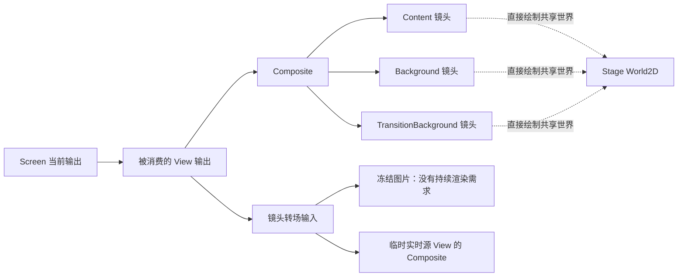

# View 渲染需求调度：代码审查与修复方案

日期：2026-09-14。状态：已完成第一版实现及回归验证。第 1–5 节保留实现前的设计审查；实际落地与验证见第 6 节。

## 决策摘要

建议由 Godot Direction 渲染后端统一管理 **View 输出的渲染需求**。第一版以整套 View 为调度单位：需要时更新五层表面，不需要时停止更新；资源与逻辑仍保留。

这不是把 `Always` 换成几个 `if`，也不需要建立覆盖所有 Godot 节点的通用 Render Graph。需要补上的核心契约是：**输出被谁使用、一次捕获何时获得新帧、使用结束后谁释放需求。**

trial00 已验证隐藏主 View 的五层更新约占 2.36ms/帧，停止后画面像素一致。但现有压力测试没有覆盖动态镜头源、Live2D 子视口、并发捕获和读档，不足以直接作为通用修复。

## 1. 当前代码的实际关系

### 1.1 数据状态、渲染输出、渲染排序是三件事

- `DirectionState` 保存逻辑 Stage/View/Screen 状态，不包含临时渲染源。
- `GodotDirectionViewSurface` 创建 Content、Background、TransitionBackground、Composite、View 五层表面。
- `PublishView()` 将前三个输入表面的 `World2D` 指向 Stage 的世界，按各自镜头投影直接绘制该世界。正常路径并不采样 StageViewport 的整张图片；原有 `Content.Texture` 被清空，旧 Canvas 被隐藏。
- `ViewportSetParentViewport` 维护提交顺序。Stage 又被锚定到永久主 View 的 ContentViewport 下面，以确保角色子视口先于各 View 绘制。这是排序关系，不能当成“父 View 显示才需要子 Stage”的消费关系。

来源：[PublishView](/Users/pakholeung/web/majo-rebuild/addons/majo_runtime/Runtime/Direction/Godot/GodotDirectionRenderHost.cs:425)、[Stage 排序锚点](/Users/pakholeung/web/majo-rebuild/addons/majo_runtime/Runtime/Direction/Godot/GodotDirectionRenderHost.cs:1194)。



图中的箭头表示消费关系，不是 SceneTree 的父子关系，也不是要重建 Godot 的提交排序图。

### 1.2 全部开启不只有一个入口

`ActivateViewports()` 把所有 Stage/View 表面设为 Always；`PublishBackdrop()`、`PublishView()`、`PublishScreen()` 和 Actor 提交都会经由 `Activate()` / `ActivateOutput()` 调用它。初始化、恢复、动态创建 View 也有直接写更新模式的路径。

因此只在 `PublishScreen()` 关闭隐藏 View，下一个角色或背景命令就可能重新开启它们。修复必须移除调度范围内的竞争写入者。

来源：[ActivateViewports](/Users/pakholeung/web/majo-rebuild/addons/majo_runtime/Runtime/Direction/Godot/GodotDirectionRenderHost.cs:1072)、[创建 View](/Users/pakholeung/web/majo-rebuild/addons/majo_runtime/Runtime/Direction/Godot/GodotDirectionRenderHost.cs:1231)。

### 1.3 屏幕绑定不等于全部渲染需求

| 使用者 | 当前实现 | 调度需要识别的语义 |
|---|---|---|
| 单画面、分屏、PIP | Screen slots 采样 View.Viewport | 当前实际绑定的 View 是持续需求根 |
| 布局移动 | `PublishScreenLayout()` 处理旧、新 slot | 消失中的旧 slot 到结束前仍可能消费 View |
| Screen dissolve | 旧 Screen 截图 + 新 Screen 实时输出 | 捕获完成后，旧 View 不必因为 dissolve 一直更新 |
| 同 Stage 镜头 dissolve | 创建临时实时源 View | 当前 View 需要源 View；源不在公开 `views` 字典中 |
| 跨 Stage 镜头切换等 | 可走冻结截图路径 | 源图与源 View 生命周期分开 |
| 捕获隐藏 View | 临时启用最外层 View 并读回 | 必须更新整套依赖，且获得本次请求之后的新帧 |
| 读档交接 | 旧画面覆盖，新场景渲染后撤覆盖 | 即使暂未显露，新 Screen 仍有显式渲染需求 |

尤其应修正“转场都要保留前后两个 View 更新”的笼统规则：冻结源与实时源必须区别处理。

来源：[Screen 转场](/Users/pakholeung/web/majo-rebuild/addons/majo_runtime/Runtime/Direction/Godot/GodotDirectionScreenBackend.cs:57)、[镜头源选择](/Users/pakholeung/web/majo-rebuild/addons/majo_runtime/Runtime/Direction/Godot/GodotDirectionViewBackend.cs:76)、[临时源 View](/Users/pakholeung/web/majo-rebuild/addons/majo_runtime/Runtime/Direction/Godot/GodotDirectionRenderHost.cs:214)。

## 2. 推荐的最小架构

### 2.1 放在 Godot 后端内部，只有一个更新模式写入者

新增小型内部组件，例如 `GodotViewRenderDemand`，由 RenderHost 持有。名字只是示意，不构成新增公共 API 的承诺。

其职责限于：

- 注册/注销 View 的实际渲染实例及五个视口。
- 保存当前 Screen 的实际消费根。
- 保存 View 到临时实时源 View 的依赖。
- 管理捕获、准备、恢复使用的临时需求令牌。
- 计算可达实例，差量应用 Always / Disabled。

它不负责演员创建、资源缓存、时间推进、事务执行、脚本命令或 GPU 提交顺序。新 View 创建后注册为无需求；准备操作确实要渲染时才申请临时需求。

逻辑上可表达为：

```text
需要更新的 View = 当前 Screen 消费根 ∪ 临时请求根 的依赖闭包
```

同一 View 被两个 slot 使用，只更新一次。多个捕获各有独立令牌，释放其中一个不会关闭另一个仍需要的输出。注册身份使用实际实例/独立代次，不能仅以可复用的公开 ViewId 为键。

第一版整套五层一起调度；暂不对可见 View 的背景子 pass 做细粒度裁剪。模型足以解决已证实的问题，规模与活跃 View 数量相关，不随角色数、纹理数或场景树节点数增长。

### 2.2 明确区分两类令牌

- **临时需求令牌**：捕获、首次准备、恢复要求一个输出至少产生新帧。它临时成为根，有取消、释放和实例有效性检查。
- **消费依赖令牌**：镜头转场的 owner View 使用实时源 View。源只在 owner 可达时需要持续绘制；不要把所有正在进行的隐藏转场都永久变成独立根。

临时实时源的流程应为：创建实例 → 注册 → 申请准备需求 → 等输入就绪 → 提交时安装 owner→source 依赖 → 释放准备需求。转场结束或取消时移除依赖，然后按现有所有权释放源对象。旧转场迟到的 Dispose 不能移除新转场的关系。

**纹理被保留不等于纹理正在被消费。**不要让每个 `GodotVisualInput.Live()` 构造都自动申请全局持续需求；它也用于动态背景和预备输入，会把隐藏输出重新拉成常驻渲染。可在 RenderHost 的 View 输入创建入口组合需求令牌与既有 release 回调，公共 VisualInput 继续表达资源生命周期。

### 2.3 保持消费规则只有一份

`PublishScreenLayout()` 对同一个 slot 优先使用 target 绑定，只有 target 缺失才使用 before，消失 slot 到 progress=1 才隐藏。简单取 before/target 全部 View 的并集虽然保守，但会产生不必要绘制，且容易与真实输出逻辑漂移。

应提取一个很小的“实际 slot 来源解析”结果，由绘制绑定和需求根共同使用。布局位置、角度、尺寸每帧变化不需要重建依赖；只有参与的实例集合变化才使需求图变脏。

来源：[布局发布](/Users/pakholeung/web/majo-rebuild/addons/majo_runtime/Runtime/Direction/Godot/GodotDirectionRenderHost.cs:523)。

### 2.4 按结构变化计算，不逐帧扫描 SceneTree

注册/销毁、Screen 来源变化、依赖令牌获取/释放、恢复重建才使需求集合变脏。重算为小规模 O(V+E) 可达性遍历，只写入模式发生变化的视口。

推荐将合并后的计算放在确定的渲染前边界；capture/ready 必须有显式的 flush/请求接口，保证等待新帧之前需求已发布。普通 pose、shake、idle 和布局插值帧不触发整图重算。

第一版无需为此改变引擎无关的 `DirectionPlan` 或扩展通用事务接口。Godot 提交本来就在同一线程按 Stage→View→Screen 同步发布，需求从发布后的渲染关系派生。必须通过首帧测试验证 flush 的时机，不能凭 FramePreDraw 名称假定所有顺序天然正确。

## 3. 必须一起处理的坑

### 3.1 捕获存在“有图片，但不是新图片”的风险

现在 `CaptureViewAsync()` 只修改外层 View 的 mode；内部四层依靠全开才工作。关闭隐藏 View 后，如果不同时启用内部依赖，读回仍能成功却得到旧画面。

更重要的是 `WaitForRenderFenceAsync()` 等的是 `SceneTree.ProcessFrame`，不是 GPU 已经产生新图像的保证。现有 `GodotVisualInput.WaitForFrameAsync()` 已有从 FramePreDraw 到 FramePostDraw 的完整提交等待，可以复用其边界思路，而不是再加固定毫秒延迟。

需要的契约应是 `EnsureRenderedAsync(输出, cancellation)`：请求依赖 → 应用需求 → 等请求后的完整提交 → 校验实例/尺寸仍有效 → 读图。若等待期间重建或 resize，应重试或明确取消，不能返回旧尺寸图片。第一版可以暂时保持 Always 到等待完成后释放令牌，不急于引入 `UpdateMode.Once`。

来源：[捕获](/Users/pakholeung/web/majo-rebuild/addons/majo_runtime/Runtime/Direction/Godot/GodotDirectionRenderHost.cs:606)、[ProcessFrame 等待](/Users/pakholeung/web/majo-rebuild/addons/majo_runtime/Runtime/Direction/Godot/GodotDirectionRenderHost.cs:497)、[完整帧等待](/Users/pakholeung/web/majo-rebuild/addons/majo_runtime/Runtime/Direction/Godot/GodotVisualInput.cs:70)。

### 3.2 不要“保存旧 mode，finally 恢复”

捕获过程中 Screen 可能开始使用这个 View。捕获结束后恢复进入前的 Disabled，会关掉现在正在显示的输出。两个请求交错也会产生类似问题。

需求令牌释放时应重新计算剩余需求，不恢复快照里的 mode。同步 `CaptureView()` 应明确只读最近已完成的图像，业务上的“捕获当前内容”走带准备保证的异步入口，避免命名和行为继续混淆。

### 3.3 隐藏不应停止模拟和过渡完成

Camera idle、镜头 tween、角色动画、背景动画、对话与音频时间仍需推进。否则镜头回到屏幕时相位倒退，隐藏过渡永不结束，wait:true、资源回收或存档会被连带阻塞。

`RunIdleLoopAsync()` 当前更新包含临时源在内的镜头相位；不要在本修复中顺手跳过隐藏实例。停止 render target 更新与停 `_Process` 是不同操作。

来源：[idle 循环](/Users/pakholeung/web/majo-rebuild/addons/majo_runtime/Runtime/Direction/Godot/GodotDirectionRenderHost.cs:802)。

### 3.4 Live2D/角色捕获的排序是第一版上线门槛

Stage 当前以主 ContentViewport 为排序锚点。trial00 使用的 layered 角色固定画面验证，不能证明“主 View Disabled、第二 View 活跃”时任意角色子视口都正确。

必须加入实时变化的子视口/遮罩测试，确认主 View 停绘不会破坏 Stage 子目标 → 第二 View 的先后顺序。若失败，应单独调整排序锚点，使“排序”和“是否绘制主镜头”解耦；不能用继续绘制整个主 View 来掩盖，也不能未经证据重排整棵视口树。

第一版不接管 `GodotActorCapturePool`、插件子视口或动态 `GodotBackgroundRaster` 的 mode。这些生产者保留自己的租约与准备行为；后续优化要有显式 producer 接口，不使用树遍历批量停用。

### 3.5 读档覆盖不是“后台场景可以不画”

`RetainedOutput` 用旧图片盖住重建过程。`WaitForTargetAsync()` 现在调用全开，再等新 Screen 渲染。替换后应该持有新 Screen 的显式准备需求，验证新图像可用再撤覆盖。

需求是瞬态渲染状态，不写进存档。reset 清空旧实例关系，新视口重新注册。旧代次捕获/转场释放对新图无影响。

来源：[读档等待](/Users/pakholeung/web/majo-rebuild/addons/majo_runtime/Runtime/Direction/Godot/GodotDirectionRenderHost.Restore.cs:87)。

### 3.6 Visible 字段不能单独判断最终需求

Screen dissolve 会暂时隐藏 `LiveOutput`，但转场 shader 仍在采样 ScreenViewport；View dissolve 同样可能隐藏 `CompositeOutput`，却继续把 Composite 当实时输入。不能因普通 TextureRect 隐藏就停掉 shader 的生产者。

闭幕遮罩完全不透明时也先不做遮挡剔除：屏幕后的场景仍可能正在准备、录制或被捕获。暂时保留 Screen 的现有连续更新策略更容易保持语义。

### 3.7 准备、回滚与销毁顺序

Composite preparation 按 Stage→View→Screen 分层，同层可并发。准备新 View 并不意味着它已经应在屏幕显示；准备需求的所有权必须跟 PreparedComponent 一起走。

成功、准备失败、部分 commit 后 rollback、被新转场替代、FinishAsync、DisposeAsync 都要释放对应令牌。保留现有“先释放 shader consumer，再释放输入 producer”的顺序。

需要检查 ResetScene(preserveGlobal)、完整 reset 与 shutdown 三条路径，不能把所有旧 Activate 调用机械地删除后漏掉首帧根。

### 3.8 Resize、暂停和后台窗口

resize 会改动所有 View 的尺寸及投影。隐藏 View 可以暂不出新图，但下一次显示或 capture 必须在新尺寸下刷新；不能将旧 `ready` 状态无限复用。

后台/最小化时可能暂时没有 FramePostDraw，headless 也没有真实图片。异步准备必须绑定取消/生命周期或上层 deadline，不能无限等待；也不能用“等到了 ProcessFrame”冒充真正完成绘制。本次初版压力探针在后台等待 FramePostDraw 的经历说明这不是纯理论风险。

## 4. 为什么不直接用其他简化方案

| 方案 | 评价 |
|---|---|
| 只改 `PublishScreen` | 其他 Activate 路径会重新全开；遗漏截图、实时镜头源和恢复 |
| 全改 `WhenVisible` | Godot 内置机制值得先做小型真实渲染验证；它是否满足当前 shader 采样、隐藏捕获、共享 World2D 与首帧排序，不能只凭名称判断 |
| 每帧扫描节点/纹理引用 | 资源引用不等于实际消费；CPU 开销随场景树增长，插件边界不清晰 |
| 将整个隐藏 Stage 暂停 | 改变模拟与等待语义，并可能破坏子视口排序 |
| 一次搭建所有 pass 的通用 Render Graph | 范围超过当前需要，会同时触碰角色捕获、背景 producer、资源和提交顺序，验证成本过高 |
| View 级显式需求 + 少量临时依赖 | 推荐；匹配已测得问题，生命周期可追踪，后续能在 View 内逐步优化 |

建议正式编码前，用现有首帧、实时输入和读档测试做一次 `WhenVisible` 的限定实验。如果内置机制在目标平台能满足全部语义，可简化模式应用层，但捕获的新帧保证和临时需求所有权仍需要明确。不要未验证就将内置机制判为不可用，也不要为了使用它改变现有转场语义。

## 5. 实施顺序与验收

### 阶段 A：固定契约和回归场景

先补能击中上述缺口的测试，再改变默认调度。特别是隐藏 View 冷启动 capture、主 View 停绘后的角色子视口首帧、实时镜头源重叠背景 dissolve，以及旧请求释放不影响新实例。

已有可扩展测试：

- `HeadlessTestRunner.CameraCutFrame.cs`：隐藏镜头同帧修改并显示，前三帧像素检查。
- `HeadlessTestRunner.BackgroundExtension.cs`：动态背景与实时旧镜头重叠，取消和资源释放。
- `HeadlessTestRunner.LiveVisual.cs`：动态输入持续推进、释放顺序。
- `HeadlessTestRunner.RenderedRestore.cs`：可见读档交接与反复恢复。
- `HeadlessTestRunner.Direction.cs`：Screen 布局及转场语义。

### 阶段 B：集中所有权并接通生产流程

1. 引入小型 View 注册/需求组件，RenderHost 成为五层 mode 的唯一写入者。
2. Screen slot 来源和实时源依赖进入需求集合；准备/capture/restore 改为令牌。
3. 保持 existing Stage/actor producer 行为、视口提交顺序与完整五层 View 路径。
4. 移除 View 范围内散落的全开和 old-mode 恢复，验证所有成功/失败/替代路径。
5. 增加低成本诊断：某 View 为什么在更新、哪些令牌持有它、活跃/总 View 数量。诊断按需导出，不逐帧输出日志。

### 阶段 C：确认收益与边界

- trial00 同构图交替测量与像素比对，窗口焦点固定；收益目标参照现有约 2.36ms，不把某次 FPS 当硬指标。
- 真实推进、分屏/PIP、同 beat 切镜头、背景/镜头/角色重叠转场、取消/回滚、resize、存档恢复。
- 活跃 View 数量与消费集合一致，测试结束后临时需求归零，没有新的一帧延迟或额外主线程读回。
- 暂不声称解决角色图集内存和切换加载尖峰；停止更新不释放约 3.3GiB 的全部渲染资源。

完成后再考虑可见 View 的 TransitionBackground 按需更新、Stage 渲染输出去冗余、静态背景缓存等独立优化。它们复用需求契约，但不应混在第一版一起改。

## 实现前的审查边界

以上结论来自当前 Screen/View/Stage、VisualInput、角色捕获池、事务准备/提交/回滚、恢复和现有渲染回归测试代码；未运行新的修复或验证新调度。正式模式应用层、FramePreDraw flush 时机以及主 View Disabled 下的子视口排序，仍需通过阶段 A 的真实渲染测试落定。


## 6. 实施记录

### 实际落地

- `GodotViewRenderDemand.cs` 是内部 View 消费关系组件，以渲染实例的注册记录区分代次。Screen 根、临时请求和带引用计数的实时源依赖共同决定需要更新的集合。它是注册后五层 View 更新模式的唯一写入者。
- `GodotDirectionRenderHost.Demand.cs` 组合 Screen 的持续输出、捕获/恢复请求、实例注册和生命周期取消。可按需调用 `InspectViewDemand()` 查看每个 View 的 Screen 根、临时请求原因、实时源及更新状态；正常游戏不逐帧生成诊断快照。
- `PublishScreen()` 与 `PublishScreenLayout()` 在实际设置 slot 纹理时收集消费实例，不单独维护另一份来源解析规则。分屏/PIP、相同 View 的多个 slot、消失中的 slot 都沿用这条路径。
- 同 Stage 镜头转场在准备时临时请求旧镜头，提交时先建立 owner → live source 依赖再释放准备请求。结束、取消、回滚、替代和销毁复用现有输入释放链。
- `CaptureViewAsync()`、`CaptureScreenAsync()` 与读档交接等待完整 FramePreDraw → FramePostDraw；请求持有期间保持依赖可用。resize 代次变化会等待下一完整帧，reset/shutdown 会取消旧等待。View 实例释放后不能把截图返回为新实例的画面。同步 `CaptureView()` 明确只读最后完成帧。
- 保持 Stage、角色 producer、后台模拟和渲染 RID 排序不变。没有引入公共渲染图、全局 VisualInput 自动保活、逐帧 SceneTree 扫描或额外常驻读回。

**刷新时机的选择：**第一版在消费关系改变时同步重算，并只写模式发生变化的实例。当前事务在 Godot 主线程同步发布，不在 Stage → View → Screen commit 中间让出执行；真实 GPU 首帧测试已验证该时机。相比新增一个 FramePreDraw 调度生命周期，同步方式更少边界，也保证捕获申请返回时需求已生效。布局插值若消费集合未变，不重算依赖图；pose/idle 更新不触发重算。

**没有将模式直接改成 WhenVisible：**此版采用可显式检查的 Always/Disabled 需求契约。未做 WhenVisible 的完整等价性实验，因此不声称 Godot 的自动可见性机制不可用；它是否可进一步简化模式应用层仍是独立候选，不影响本版明确捕获与消费所有权。

### 验证

日志归档：`artifacts/view-render-demand/20260914/`。

- `tools/test.sh --fast`：582 项 C# 单元测试、Godot headless 集成测试及失败退出码检查通过，构建无警告/错误。
- 新增 `--majo-view-demand` 回归：五层同步启停、重叠捕获/需求释放、屏幕在捕获期间获得所有权、实时源依赖、重复依赖令牌、布局 slot 重绑定/消失、split/PIP/共享 View、ViewId 重用、永久 main 实例 reset、取消和 reset 中的捕获。
- 真实 Metal GPU：隐藏 View 冷截图及再次更新截图得到正确颜色；resize 中捕获得到新尺寸；主 View Disabled 时，原生角色子 SubViewport 六帧交替颜色均在第二镜头首帧正确显示。
- `--majo-camera-cut`：六次切镜头，每次前三帧像素正确，并检查隐藏 View 停绘。
- `--majo-live-visual`、`--majo-background-extension`、`--majo-layered-masks`：实时 actor 输入、背景与镜头重叠 dissolve、临时准备到消费依赖交接、结束后的需求释放、背景取消/回滚与合成遮罩通过。
- `--majo-render-restore`：200 次完整 StateManager 读档交接，检查 600 帧，节点数 62，候选创建/释放均为 200，最大同时活动候选为 1。测试包含冻结覆盖、分屏、新建第二 Stage/View。
- trial00：五个阶段焦点均为 100%，像素哈希与实现前相同，正常调度活跃 SubViewport 8、draw call 46；全开对照分别 13、57。详见 `trial00-stress-test.md` 的实施后验证。

本版确认去掉隐藏 View 的冗余工作，并守住上述渲染与生命周期契约。trial00 固定首句基准不是完整剧本的性能承诺；资源加载尖峰、纹理内存、每个可见 View 的内部 pass 裁剪不在本次结论中。原生子视口与合成遮罩通过，也不代表已测试每一个第三方 Live2D 模型。
