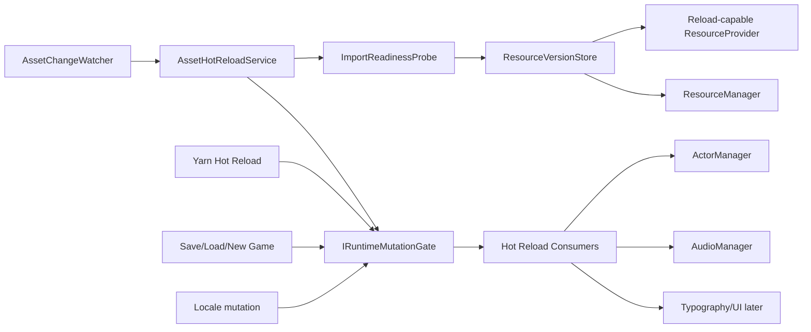
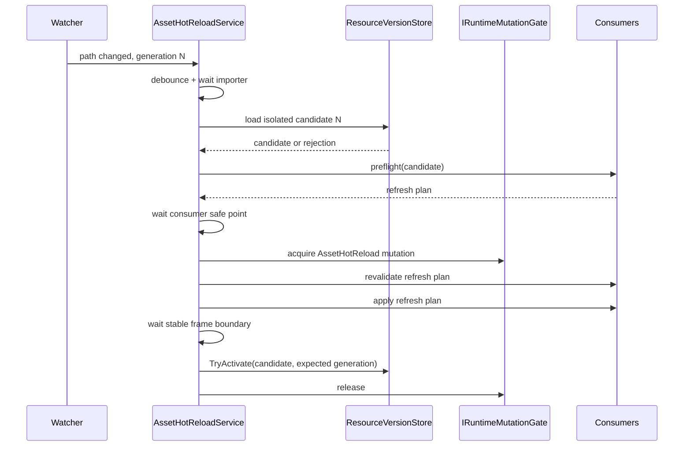

# Asset Hot Reload 技术方案

状态：Draft  
目标：在 Godot Editor/Debug 开发期，安全地更新 Majo Runtime 引用的图片、音频及部分 UI 资源  
与 Yarn Hot Reload 的关系：独立服务，共享 Runtime mutation/pause 边界，但不重新执行 Yarn command

## 0. 结论与复杂度

整体复杂度为中高，建议先验证 Godot importer/cache 的可行性，再拆成两个能力交付：

1. **Next-use reload**：同路径资源保存后，下一次加载能够取得新对象。
2. **Live rebind**：已经显示或正在使用该资源的 Runtime consumer 主动换用新对象。

第一项主要改造资源缓存，边界清楚；第二项必须分别定义 Texture、Audio、Font、Theme、Scene
的运行中替换语义，不能用一个通用 `Reload()` 粗暴处理。

推荐 MVP 只支持：

- Texture2D next-use reload；
- 当前 Character/Background appearance 在稳定状态下的无动画 live rebind；
- AudioStream next-use reload；
- 当前 BGM、Voice、SFX 不自动重启；
- 加载失败保留 Last Known Good asset；
- PackedScene、Shader、Theme、Font 的 live rebind 延后。

在正式改造缓存前必须先完成 provider/importer feasibility spike，证明同一路径 Texture2D、
AudioStream 在 Editor importer 完成后可以稳定取得内容和对象身份都不同的新对象。若 Godot 的
cache mode 无法满足隔离加载，需要先确定版本临时路径或专用 decoder 方案，不能带着该不确定性进入
ResourceManager 重构。

## 1. 目标

- 监听项目内允许的 Asset 源文件变化。
- 避免 Majo `ResourceManager` 和 Godot `ResourceLoader` 返回旧缓存对象。
- 同一路径的新版本与仍被使用的旧版本可以短暂共存。
- 新版本加载、类型检查或应用失败时，当前画面和声音不受影响。
- 当前 Actor 在 appearance transition 稳定后，可以在保持位置、透明度、可见性、层级和稳定状态的
  情况下刷新贴图；transition 进行中只排队，不打断或重建动画。
- Asset reload 与 Yarn reload、Save/Load、New Game、Locale mutation 不并发修改 Runtime。
- Debug Overlay 和结构化日志能说明 detected、waiting、applied、rejected、superseded。

## 2. 非目标

MVP 不处理：

- Release Build 运行时换资源；
- 任意外部目录资源直接注入导出包；
- 自动重新执行 Yarn 中当前行以前的 `char`、`back`、`bgm` command；
- 在运行中整体替换任意 `PackedScene` 实例；
- 保持音频播放进度的无缝 AudioStream 替换；
- Shader、Material、Theme 任意依赖图的递归刷新；
- 修改 Actor/Audio 的配置定义后自动重建服务容器。

## 3. 为什么不能只清空 Dictionary

当前资源链路存在两层缓存：

```text
Majo ResourceManager cache
        -> GodotProjectResourceProvider
        -> Godot ResourceLoader cache (CacheMode.Reuse)
```

只从 `ResourceManager.loaded` 删除条目仍可能从 Godot `ResourceLoader` 取回同一个旧对象。
直接用 `CacheMode.Replace` 原地替换也不安全：旧对象可能正被 Actor、Audio backend、预加载 lease
或用户代码持有，原地改变会绕过 consumer 的事务边界。

因此资源缓存需要从“每个 CacheKey 一个对象”升级为“每个 CacheKey 一个 Active generation，旧
generation 可在 Runtime 管理的 lease 释放前继续被版本仓库持有”。普通 `Load` 返回的裸 Godot
引用不在 lease 计数内；版本仓库退休旧 entry 后，外部仍持有的 `RefCounted` 引用可以继续存活，但
不再计入 ResourceManager 的可控缓存预算。

## 4. 支持层级

| 层级 | 能力 | MVP |
| --- | --- | --- |
| L0 Detect | 检测文件变化并生成 generation | 是 |
| L1 Refresh-on-next-use | 后续 `Load/LoadAsync` 返回新资源 | 是 |
| L2 Live rebind | 当前 consumer 主动切换到新资源 | Texture2D only |
| L3 Structural reload | 重建 Scene、Theme、Shader 依赖图 | 否 |

## 5. Asset 类型语义

| 类型 | Next-use | Live rebind | MVP 规则 |
| --- | --- | --- | --- |
| Texture2D | 是 | 是 | 当前 Actor 重新绑定同 appearance 的新 Texture |
| AudioStream | 是 | 否 | 当前播放保持旧 stream；下一次播放使用新 stream |
| Font | 后续 | 后续 | 需要更新 FontCatalog 并重新 ApplyTypography |
| Theme | 后续 | 后续 | 需要重新投影到所有 Runtime UI root |
| Shader/Material | 后续 | 否 | 依赖和实例共享关系复杂，不自动刷新 |
| PackedScene | 后续 | 否 | 已实例化 Node 不自动替换 |
| 外部本地化文件 | 独立方案 | 独立方案 | 不混入 Asset MVP |

### 5.1 Texture2D

当前 Actor live rebind 必须保留：

- Actor ID、factory type；
- appearance ID 与 target appearance；
- position、scale、z-index；
- opacity、visibility；
- Background slot；
- layered character 当前 layer composition。

刷新不重新执行剧情 command，不触发 show/hide/crossfade，不写 History/Played/Save。

MVP 只在 Actor 的 appearance property 没有进行 transition 时提交 live rebind。若 Actor 正在
crossfade 或 layered appearance transition：

1. Candidate 保持未发布状态并进入 `PendingSafePoint`；
2. 等待该 Actor 的 appearance operation 到达稳定状态；
3. 重新检查当前 appearance、target appearance 和资源依赖；
4. 仍引用该路径时才生成 refresh plan，否则该 consumer 从 plan 移除。

等待 safe point 超过 `SafePointTimeoutMilliseconds` 时，不强行修改 Actor；该 candidate 降级为
next-use-only，激活后记录 `RefreshedForNextUse` 和受影响但未刷新 consumer。后续是否提供手动 retry
属于 Debug Overlay 体验，不在自动事务内。

不允许通过再次调用 `SetAppearance` 实现刷新，因为该调用可能取消正在运行的 property operation。
后续如需支持动画中刷新，必须跟踪 current/target texture、crossfade previous/next view，以及
LayeredCharacter 每个 `AtlasTexture.Atlas` 的实际引用，并为它们提供独立回滚快照。

### 5.2 AudioStream

- 当前 BGM 不重启，避免播放位置跳回开头。
- 当前 Voice/SFX 不替换，避免重复语音或音效。
- 新的 `PlayBgmAsync`、`PlayVoiceAsync`、`PlaySfxAsync` 取得新 generation。
- Debug Overlay 可提供显式“Restart current BGM with latest asset”，但不属于自动路径。

### 5.3 PackedScene 与 Theme

运行中替换 scene 需要迁移 Node 状态、signal、输入 scope、service 引用和用户脚本状态，风险远高于
贴图替换。MVP 只记录资源已变化，并提示 restart required。

## 6. 总体架构



建议组件：

| 组件 | 职责 |
| --- | --- |
| `IAssetChangeWatcher` | 监听允许目录，规范化路径，产生 change hint |
| `IAssetImportReadinessProbe` | 等待 Godot importer 完成并验证可加载性 |
| `IResourceInvalidationService` | 为逻辑 key/解析路径登记 candidate，但不停止 Active/LKG 服务 |
| `IResourceVersionStore` | 管理 Active、Candidate、LKG 和退休 generation |
| `IAssetHotReloadConsumer` | 对某类 live object 做 preflight/apply/rollback |
| `IAssetHotReloadService` | generation 合并、事务编排、状态和日志 |
| `IRuntimeMutationGate` | 串行化 Yarn、Asset、Save/Load、New Game、Locale 的 Runtime mutation |

`IRuntimeMutationGate` 是本方案的前置依赖，不等同于 `PlaybackPause`。它至少需要定义：

- mutation kind、owner 和可诊断的等待状态；
- 是否允许同一 owner 重入；MVP 默认不可重入；
- lock ordering，禁止 consumer 在持有局部锁时反向申请全局 gate；
- preflight/candidate load 在 gate 外执行，最终状态复核、apply、rollback 在 gate 内执行；
- cancellation、apply timeout，以及 owner 异常退出时的可靠释放；
- 获取 gate 后同步取得对应的 playback pause/progression freeze，释放顺序与获取顺序相反。

Yarn Hot Reload、GameSession/SaveLoad、Locale mutation 必须迁移到同一个 gate 后，Asset Hot Reload
才可宣称与它们串行。各服务现有的私有 `SemaphoreSlim` 可以继续保护服务内部状态，但不能替代该 gate。

## 7. 数据模型草案

```csharp
public enum AssetHotReloadState
{
    Disabled,
    Watching,
    Debouncing,
    WaitingForImport,
    LoadingCandidate,
    PendingSafePoint,
    Applying,
    RollingBack,
    WatchingWithError,
}

public enum AssetHotReloadOutcome
{
    Applied,
    RefreshedForNextUse,
    RestartRequired,
    UnsupportedType,
    ImportRejected,
    LoadRejected,
    SourceMissing,
    Superseded,
    RolledBack,
}

public sealed record ResourceInvalidationRequest(
    string ProviderId,
    string ResolvedPath,
    Type ResourceType,
    long Generation,
    string? BatchId,
    string SourceFingerprint);

public sealed record ResourceVersionChanged(
    string ResolvedPath,
    Type ResourceType,
    long PreviousGeneration,
    long CurrentGeneration,
    object Resource);
```

`AssetHotReloadState` 只表示服务当前执行阶段；`RestartRequired`、最近失败、单个资源的等待状态属于
attempt/version outcome，不把整个服务永久置于某个资源的状态。Debug Overlay 应显示全局 service
state 加最近 attempt 列表。

Generation 的作用域是 `CacheKey = (ResourceType, ProviderId, ResolvedPath)`，而不是全局 watcher
计数器。只有同一 CacheKey 的 N+1 可以 supersede N；不同路径的变化必须独立完成。一次编辑操作涉及
多个资源时，可以用可选 `BatchId` 聚合诊断和事务，但 batch 不能改变每个 CacheKey 的单调代次。

资源版本条目至少包含：

```text
CacheKey
Generation
Resource object
State: CandidatePending | CandidateReady | Active | Retired | Rejected
LeaseCount
PinnedLeaseCount
LoadedAt
SourceFingerprint / imported fingerprint
```

普通异步 Load、candidate load 和 lease acquisition 都必须绑定具体 generation/version entry。完成回调
发布结果前要比较当前代次；过时代次只能完成其既有调用方，不能覆盖更新的 Active。

## 8. ResourceManager 改造

### 8.1 新接口

```csharp
public interface IResourceInvalidationService
{
    ResourceInvalidationResult InvalidateResolvedPath(
        ResourceInvalidationRequest request);

    Task<ResourceCandidate<TResource>> LoadCandidateAsync<TResource>(
        ResourceKey key,
        string? overridePath,
        long generation,
        CancellationToken cancellationToken = default)
        where TResource : class;

    bool TryActivate<TResource>(
        ResourceCandidate<TResource> candidate,
        long expectedActiveGeneration)
        where TResource : class;

    void Reject(IResourceCandidate candidate);
}
```

`Invalidate` 不销毁旧对象，只做以下事情：

1. 为目标 CacheKey 分配/登记 `CandidatePending` generation。
2. 当前 Active 同时也是 LKG，在 candidate commit 前继续服务所有普通 `Load/LoadAsync`。
3. candidate 使用 bypass-cache provider 路径加载新对象，不写入普通 cache。
4. candidate 通过 importer、类型、内容和 consumer preflight 后进入 `CandidateReady`。
5. 最终 commit 使用 `expectedActiveGeneration` 做 compare-and-swap；验证通过才成为 Active。
6. candidate 失败、超时、source missing 或被 supersede 时，Active/LKG 完全不变。
7. 旧 Active 变为 Retired，并在对应 generation 的 manager-owned lease 释放后从版本仓库移除。

这意味着 invalidation 到 candidate commit 之间，新的普通 Load 暂时取得 LKG 是预期行为。不能通过先
删除/跳过 Active 再尝试加载 candidate，否则损坏文件和 importer 竞态会破坏 LKG 保证。

普通同步/异步 Load 也必须加入 generation-aware publication：provider load 启动时捕获目标 version，
完成时只有在该 version 仍允许发布的情况下才能更新 Active。旧 load 在 N+1 commit 后完成时，可以向
已经等待它的调用方返回结果，但不得反向覆盖 N+1。

### 8.2 Godot provider

为 provider 增加显式 reload API，不能继续固定使用 `CacheMode.Reuse`：

```csharp
Task<object> ReloadAsync(
    ResourceLocation location,
    Type resourceType,
    CancellationToken cancellationToken);
```

候选加载应取得独立对象，避免在 commit 前修改旧对象。具体采用 `Ignore`、`IgnoreDeep` 或带版本
临时路径的策略，必须在 Phase 0 用 Godot Editor/headless 集成测试验证 Texture2D、AudioStream 及其
subresource 行为后确定。验证至少包括对象身份、实际像素/音频内容、同步与 threaded load，以及旧对象
未被原地修改；未通过前不开始 Phase B 的缓存结构重构。

Watcher 回调只产生纯数据 change hint。所有 Godot `ResourceLoader` 调用、Godot Object 的创建/释放
和 live consumer apply 都必须通过捕获的 main `SynchronizationContext` 或等价 dispatcher 回到主线程；
文件 fingerprint 计算和普通文件 I/O 可以在后台线程执行。

### 8.3 Lease 和 pinned resource

- pinned/leased 旧版本允许继续使用。
- 新 Load 获取 Active 新版本。
- 旧 lease Release 只减少对应 generation 的计数。
- lease acquisition 内部持有 version entry identity 或 `(CacheKey, Generation)`，不能只保存 CacheKey。
- 不能沿用当前 `CacheKey -> CacheEntry` 单条结构，否则新旧 lease 会计到错误对象。
- cache budget 统计版本仓库仍持有的所有 generation；外部通过裸 `Load` 长期持有的 Godot 引用不在
  可控 lease 预算内，诊断中必须明确这是 manager-held estimate。
- rejected candidate 和已满足退休条件的 entry 要在主线程释放版本仓库持有的 Godot 引用；Runtime
  shutdown 必须释放 CandidatePending、CandidateReady 和 Retired entry。

## 9. 文件检测与 importer 边界

### 9.1 Editor MVP

第一版只支持 Godot Editor 内的 `res://` 项目资源：

- 监听配置允许的 Asset 根目录；
- 默认扩展名：png、jpg、webp、svg、wav、ogg、mp3；
- changed/created/renamed 只产生 change hint；
- debounce 后等待 importer 产物稳定；
- 同一 CacheKey 的连续变化只提交最新 generation，不同路径互不 supersede；
- MVP 的 WatchRoot canonicalize 后必须仍位于 Godot project root，项目外目录直接拒绝。

不能在文件 Changed 事件后立即 Load，因为 watcher 可能早于 Godot importer 完成。源文件稳定、
`ResourceLoader.Exists` 和 candidate 可加载都不能证明本次 import 已完成；旧 imported artifact 也可能同时
满足这三个条件。Readiness probe 至少要：

1. change detected 时记录 canonical source path、source fingerprint 和目标 CacheKey；
2. 等待源文件 size/mtime 连续两次稳定，再重新计算 fingerprint；变化则产生同 key 的下一 generation；
3. 等待 Godot Editor importer/reimport completion signal 覆盖该 `res://` path；若接口不可用，则必须
   证明 imported artifact fingerprint/mtime 对应当前 source fingerprint，不能只轮询 `Exists`；
4. 等待 `ResourceLoader.Exists(path, type)` 并隔离加载 candidate；
5. 验证 candidate type、对象身份和基本内容，且记录 current source/imported fingerprint；
6. importer 完成后如果发现 source fingerprint 已改变，当前 generation 标记为 Superseded 并重新等待；
7. 超时、删除或损坏则 reject，LKG 继续服务普通 Load；后续 importer completion 或新的 source event
   可以触发新 generation，不能把一次超时永久记为已处理。

`renamed` 必须拆成 old path 的 source-missing hint 和 new path 的 created hint。old path 保留 LKG；new
path 只有在能解析为已知 CacheKey/consumer dependency 时才创建 candidate。Watcher 事件允许重复、乱序，
一致性扫描负责补回丢失的事件。

### 9.2 Debug Export

Debug Export 没有稳定 Editor importer 生命周期。MVP 不承诺从外部源码目录导入任意 Asset。
后续若支持，需要独立 runtime decoder，例如 Image.Load + ImageTexture、AudioStreamWav decoder，不能直接
复用 Yarn 的 `SourceRootOverride` 语义。

## 10. 应用事务



事务规则：

1. Candidate load 失败不触碰 Active/LKG，pending 期间普通 Load 继续取得 LKG。
2. Consumer preflight 必须无副作用，并在 mutation gate 外完成；进入 gate 后必须重新验证 consumer
   identity、appearance dependency、safe point 和 expected Active generation。
3. 先准备所有新对象和旧引用回滚快照，再切换 consumer；candidate 此时仍未向普通 Load 发布。
4. Live consumer 全部 apply 且至少一个 process frame 稳定后，才以 compare-and-swap 激活 candidate。
   next-use-only 资源可以在进入 gate 并复核 generation 后直接激活，不需要等待画面稳定帧。
5. 任一 consumer apply、稳定帧观察或最终 Activate 失败时，已切换 consumer 恢复旧引用，candidate
   Reject，Active/LKG 保持不变。旧对象在事务完成前不得退休。
6. 新 generation 在 apply 期间到达时，当前事务完成 revalidate/compare-and-swap 后必须变为
   Superseded；`TryActivate` 除 Active generation 外还必须确认 candidate 仍是该 CacheKey 的最新 generation，
   不能覆盖更新的 candidate。
7. TryActivate 成功后才发布 `Applied`。稳定帧发生在发布前，因此观察失败时 candidate 从未对普通 Load
   可见。
8. Mutation gate 串行化 Runtime mutation，不阻止只读观察。事务允许普通 Load 在 commit 前短暂取得旧
   Active，但绝不允许它在失败事务中取得未发布 candidate。

## 11. 与 Yarn Hot Reload 的关系

两个服务彼此独立：

- Yarn watcher 只处理 `.yarn`、`.yarnproject`。
- Asset watcher 只处理配置允许的资源扩展名。
- 二者使用不同 generation 和 LKG。
- 二者共享 mutation/pause gate，不能同时 apply。
- Asset reload 不触发 `HotReloadReplay`，也不重新执行 Yarn command。

例如当前 Actor appearance 为 `maya/angry`：

- 修改 `angry.png`：Asset consumer 可以直接给 Actor 重绑新 Texture。
- 修改 Yarn command `appearance:angry` 为 `appearance:shocked`：由 Yarn reload 更新后续 Program；
  不追溯执行该 command。

## 12. 配置草案

```csharp
[GlobalClass]
public partial class AssetHotReloadConfiguration : Resource
{
    [Export] public bool Enabled { get; set; }
    [Export] public string[] WatchRoots { get; set; } = [];
    [Export] public string[] Extensions { get; set; } =
        ["png", "jpg", "webp", "svg", "wav", "ogg", "mp3"];
    [Export] public int DebounceMilliseconds { get; set; } = 250;
    [Export] public int ImportTimeoutMilliseconds { get; set; } = 5000;
    [Export] public int SafePointTimeoutMilliseconds { get; set; } = 10000;
    [Export] public int ApplyTimeoutMilliseconds { get; set; } = 5000;
    [Export] public bool RefreshVisibleTextures { get; set; } = true;
    [Export] public bool RefreshAudioOnNextUse { get; set; } = true;
}
```

约束：

- Editor 可显式启用，默认关闭。
- Debug Export 默认关闭。
- Release 强制关闭。
- Debounce 可为 0；Import、SafePoint 和 Apply timeout 必须大于 0。
- Editor MVP 的 WatchRoot canonicalize 后必须位于 Godot project root；项目外目录配置校验失败。
- 外部 WatchRoot 只在后续具有独立 runtime decoder、路径沙箱和明确 Debug Export 开关时重新设计，
  不复用 Yarn `SourceRootOverride`。

## 13. 诊断

建议事件：

```text
asset.hot_reload.change_detected
asset.hot_reload.waiting_for_import
asset.hot_reload.candidate_loaded
asset.hot_reload.pending_safe_point
asset.hot_reload.applied
asset.hot_reload.next_use_only
asset.hot_reload.restart_required
asset.hot_reload.rejected
asset.hot_reload.source_missing
asset.hot_reload.rolled_back
asset.hot_reload.superseded
```

日志 properties：

- logicalKey；
- resolvedPath（日志中使用项目相对路径）；
- resourceType；
- generation；
- batchId；
- expected/current Active generation；
- source/import fingerprint；
- import readiness reason/signal；
- affected consumer IDs；
- outcome；
- elapsed；
- callback/apply thread 标识，便于诊断错误的非主线程 Godot 调用。

Debug Overlay 分开显示全局 service state 和最近 attempt 列表。每条 attempt 显示路径、generation、
受影响 Actor、是否只在 next-use 生效、是否需要 restart、等待 importer/safe point 的原因，以及最近错误。
单个资源的 `RestartRequired` 或失败不能把整个服务锁在非 Watching 状态。

## 14. 测试矩阵

### 14.1 ResourceManager 单元测试

- invalidate/candidate pending 期间普通 Load 继续返回 Active/LKG；
- candidate 成功 commit 后普通 Load 才返回新 Active；
- candidate 失败保留 LKG；
- generation N+1 supersede N；
- A、B 两个不同 CacheKey 快速变化时都能提交，不互相 supersede；
- 同路径不同 type 不互相失效；
- 普通异步 load N 在 N+1 激活后完成时不会覆盖 N+1；
- candidate N 之后登记 N+1 时，N 的 compare-and-swap 失败；
- 旧 leased generation 与新 Active generation 共存；
- lease release 只减少其实际 version entry 的计数；
- pinned 旧版本在 release 前不回收；
- cache budget 正确统计 manager-held 多 generation，并明确不代表外部裸引用；
- rejected candidate 在主线程释放且从版本仓库移除；
- shutdown 会释放 candidate 和 retired entry。

### 14.2 Godot provider headless 测试

- 修改同路径 PNG 后隔离加载得到不同 Texture 对象和像素；
- 修改 WAV/OGG 后 next-use 得到新 AudioStream；
- 源文件已稳定但 importer 尚未完成时，不会把旧 imported artifact 提交为新 generation；
- importer completion 对应的 source/import fingerprint 不一致时继续等待或 supersede；
- 损坏图片/音频保留旧对象；
- 同一路径连续保存只应用最后 generation；
- 不同路径连续保存各自应用最新 generation；
- watcher 重复、乱序、rename 和 source deletion 不会丢失 LKG；
- watcher 后台回调不会直接调用 Godot API，candidate load/apply 都发生在主线程。

### 14.3 Live consumer headless 测试

- 当前 Character texture 更新但 transform/opacity/visibility 不变；
- 当前 Background slot 和 z-order 不变；
- layered character composition 不变，仅相关 layer texture 更新；
- appearance/crossfade transition 进行中只进入 PendingSafePoint，不取消、完成或重建动画；
- safe point 到达后重新验证 dependency，已不再引用该路径的 Actor 不刷新；
- safe point 超时后降级为 next-use-only，不强行刷新 Actor；
- candidate apply 期间到达 N+1 时，N 的 compare-and-swap 失败且 consumer 回滚；
- consumer apply 中途失败时，所有已切换引用恢复旧 Texture，普通 Load 从未观察到 candidate；
- 当前 BGM/Voice/SFX 不重启；
- 下一次播放使用新 AudioStream；
- Asset apply 与 Yarn apply、Save/Load、New Game、Locale mutation 不重叠；
- mutation gate 的等待、取消、超时、owner 异常释放和 lock ordering 均有测试；
- reload 后至少一个 frame 保持稳定。

## 15. 分阶段实施

### Phase 0：Provider 与 importer 可行性验证

- 在真实 Godot Editor import 流程中记录 source event、reimport completion 和 imported artifact 时序。
- 验证 PNG/JPG/WebP/SVG/WAV/OGG/MP3 的 `Ignore`、`IgnoreDeep`、threaded load 和临时版本路径。
- 断言新对象身份和内容均变化，旧对象未被原地修改。
- 确定 importer completion 与 source/import fingerprint 的关联方式。

完成标准：选定并记录可重复的隔离加载方案；若无法可靠实现，则不进入 Phase B–F，并另行设计临时
路径或 runtime decoder。Phase A 的共享 gate 可作为独立 Runtime 改进继续进行。

### Phase A：共享 Runtime mutation gate

- 增加 `IRuntimeMutationGate`、mutation kind、owner、诊断和 timeout。
- 明确不可重入规则、lock ordering、pause/progression freeze 的获取与释放顺序。
- 接入 Yarn Hot Reload、GameSession/SaveLoad、New Game 和 Locale mutation。
- 完成等待、取消、异常释放和跨服务不重叠测试。

完成标准：现有 Runtime mutation 使用同一串行化边界，Asset 服务可以复用该边界而非新增私有锁。

### Phase B：版本化资源缓存

- 增加 invalidation/candidate/activate API。
- 将 CacheKey 单 entry 改为 generation-aware entry。
- 增加 provider bypass-cache reload 能力。
- 将 pending load、lease acquisition 和 release 绑定具体 generation。
- 增加 expected-generation compare-and-swap，阻止旧异步 load 反向覆盖 Active。
- 完成 ResourceManager 和 Godot provider 测试。

完成标准：candidate pending/失败时 Load 继续取得 LKG；commit 后取得新对象；旧 lease 和过时异步 load
不会影响新 Active。

### Phase C：Watcher、import readiness 与服务编排

- 增加配置、watcher、按 CacheKey 的 debounce/generation、rename 处理和一致性扫描。
- 接入 Editor importer completion 与 source/import fingerprint 校验。
- 建立后台 watcher 到 Godot 主线程 dispatcher 的明确边界。
- 增加状态、结构化日志和 Debug Overlay 摘要。
- Release 强制禁用。

完成标准：保存合法/非法 Asset 都不会破坏 Runtime；同路径只应用最新 generation，不同路径均能提交；
旧 imported artifact 不会冒充新 generation。

### Phase D：Texture live rebind

- Actor 暴露当前 resource dependency 或 refresh plan。
- Character、Background、LayeredCharacter 分别实现无副作用刷新。
- 为旧 Texture 引用建立 rollback snapshot，禁止通过 `SetAppearance` 刷新。
- appearance transition 期间进入 PendingSafePoint，稳定后重新验证 dependency。
- 与共享 Runtime mutation gate 串行化，并在主线程 apply。

完成标准：当前画面同路径贴图保存后自动刷新；Actor 稳定状态不变；进行中的 appearance transition
不被打断；apply/activate 失败时完整回滚且 candidate 从未向普通 Load 发布。

### Phase E：Audio next-use 与体验完善

- 验证各 AudioStream 类型 reload。
- 保持当前 playback，下一次播放使用 Active generation。
- Debug Overlay 提供可选的显式 BGM restart。

### Phase F：Font/Theme/Scene 可行性评估

在 MVP 数据和测试稳定后单独设计，不默认继承 Texture 的 live rebind 语义。

## 16. 主要风险

| 风险 | 缓解 |
| --- | --- |
| Godot importer 与 watcher 竞态 | Editor reimport completion + source/import fingerprint + candidate 隔离加载 |
| 旧 imported artifact 被当作新 generation | fingerprint correlation；Phase 0 时序测试；完成信号后才加载 |
| `ResourceLoader` 再次返回旧对象 | provider reload API + 对象身份/内容测试 + 必要时版本临时路径 |
| 旧异步 load 覆盖新 Active | generation-aware pending load + expected-generation compare-and-swap |
| candidate 在失败事务中提前泄漏 | Active 保持服务 LKG；consumer 成功后才 TryActivate |
| 旧 lease 被错误计入新对象 | lease 绑定 version entry identity，而不是只绑定 CacheKey |
| live Actor 更新中间态闪烁 | prepare 全部新 Texture，主线程 commit，失败时按引用快照回滚 |
| appearance transition 被刷新打断 | MVP 等待 stable safe point，禁止通过 SetAppearance 刷新 |
| Audio 自动重启产生副作用 | MVP current playback 不刷新 |
| 与 Yarn/Save/Load/Locale 并发 | 所有 mutation 接入同一个 `IRuntimeMutationGate` |
| watcher 后台线程调用 Godot API | watcher 只产出数据；ResourceLoader 和 consumer apply 调度到主线程 |
| 不同路径错误互相 supersede | generation 以 CacheKey 为作用域，BatchId 只聚合不替代代次 |
| 内存短时翻倍 | manager-held retired generation 计入 budget，lease 释放后移除仓库引用 |
| 任意 Scene reload 破坏服务引用 | MVP 明确 restart required |

## 17. MVP 验收标准

1. Phase 0 证明 importer completion 后，同路径 Texture/Audio 可取得身份和内容均不同的新对象，旧对象
   未被原地修改。
2. 保存当前显示 Character/Background 的同路径 Texture 后，画面自动更新。
3. Actor 的位置、透明度、可见性、slot、z-order、appearance ID 和稳定 operation state 不变。
4. appearance transition 进行中不刷新、不取消动画；稳定后仍引用该路径时才应用 candidate。
5. candidate pending、import 超时、source deletion 或损坏时，当前 consumer 和新的普通 Load 都继续使用
   LKG，日志提供明确诊断。
6. 同路径 Audio 修改后，当前播放不中断，成功 commit 后的下一次播放使用新版本。
7. 持有旧 lease 时，新 Load 能获得新 generation；release 只影响旧 version entry，旧 consumer 不崩溃。
8. 普通异步 load N 即使在 N+1 激活后完成，也不能覆盖 N+1。
9. 同一路径连续十次快速保存只应用最后 generation；两个不同路径快速保存时两者都应用各自最新版本。
10. 任一 live consumer apply 或 Activate 失败时整体回滚，普通 Load 从未观察到失败 candidate。
11. 与 Yarn Hot Reload、Save/Load、New Game、Locale mutation 同时发生时通过共享 gate 串行，无 stuck
    phase，取消或异常不会遗留 gate/pause。
12. 所有 Godot resource load、释放和 live apply 都在主线程执行，后台 watcher 不直接访问 Godot API。
13. Editor MVP 拒绝项目外 WatchRoot；Release Build 不启动 Asset watcher。
