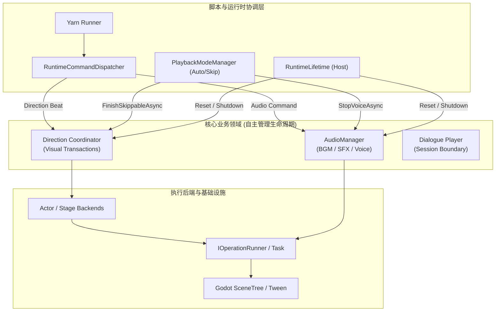

# Operation 架构重构实施方案 (v2：领域自治收敛版)

## 1. 架构愿景与重构动机

### 1.1 为什么必须重构？
在早期架构中，Yarn 脚本支持作者直接编写 `<<await>>`、`<<cancel>>` 等异步流程控制指令，并附带 `operation:<id>` 与 `group:<id>` 标识。为了支撑这一需求，系统引入了全局中心化的 `OperationScheduler`，承担了：
- 全局 Operation 的启动与底层 Tween/Task 驱动；
- 全局 Id 与 GroupId 的注册、反查与状态缓存；
- 跨模块的 `WaitAsync(OperationTarget)`、`CancelAsync(OperationTarget)`、`CompleteAsync(OperationTarget)`；
- Skip 快进时的 `CompleteSkippableAsync(groupId)`。

随着系统演进，作者层的 `await`、`cancel` 命令已被彻底废除，视觉演出全面收敛进入 **Direction 事务体系**（具备完备的 `DirectionPlan`、`IDirectionBeatRuntime` 与 `IDirectionTransactionCoordinator`）。全局调度器已经完全脱离了业务实际需求，演变为一个典型的**“架构膨胀中心与倒挂耦合点”**：
1. **全局寻址在生产代码中沦为死代码**：全局搜索确认，生产代码中对 `OperationTarget` 的调用次数为 **0**，所有的 `WaitAsync(OperationTarget)` 均只出现在单元测试的 mock 中。
2. **Skip 快进链路严重倒挂**：快进系统必须通过 Yarn 行级注解（`#majo:operation-group=`）提取 `CorrelationGroupId`，再通过 `OperationScheduler` 全局寻址去强制完成动画；而事实上视觉演出层已有完全自内聚的 `IDirectionTransactionCoordinator.FinishSkippableAsync()`。
3. **基础设施句柄跨领域泄漏**：`IActor`、`ICharacterActor`、`StageOperationSpec`、`AudioPlaybackResult` 的公开 API 依然大量暴露 `IOperationHandle`、`operationId`、`groupId`，导致上层业务与底层调度原语强绑定。
4. **对话层越权追踪底层句柄**：`RuntimeCommandDispatcher` 强行持有一组 `dialogueOperations`，通过 `Track(IOperationHandle)` 收集底层句柄并在对话停止时暴力取消，破坏了领域的内聚清理责任。

### 1.2 v2 方案相比 v1 方案的重大升级
旧版方案（v1）指出了核心痛点，但存在过度抽象与实施路径不敏捷的问题。v2 方案在此基础上做出关键升级：
- **拒绝过度抽象的“分层 Scope 树”**：v1 拟引入 `Runtime operation root -> Direction scope / Audio scope / Legacy scope`。实际上全系统只有视觉和音频两个领域使用底层异步效果，在 Operation 上再封装一层层级 Scope 树是“用新的抽象掩盖旧的上帝对象”。v2 明确主张**领域即 Owner**，各领域自闭环管理内部 Task/Tween，Operation 退化为无状态的轻量执行原语。
- **死代码前置切除**：由于业务层早已无人调用 `OperationTarget`，无需在过渡期保留庞大的全局 Id/Group 缓存字典，Phase 1 即可将死接口降级清理。
- **高 ROI 链路优先破局**：将 `PlaybackModeManager` 接入现成的 `DirectionTransactionCoordinator.FinishSkippableAsync()` 提前至 Phase 2，第一时间拔除系统最深的跨领域暗刺。

---

## 2. 核心行为契约（不可妥协的铁律）

重构必须坚守以下三条核心契约，任何设计都不得打破：

### 2.1 Settlement、Cancel、Finish 是三套独立的生命周期语义
不能用一个通用的 `CancellationToken` 抹杀这三者的区别：
- **Settlement（自然达成）**：动画或渐变平滑过渡到目标态（例如 Tween 正常播放完毕）。
- **Cancel（中途取消/回滚）**：打断当前效果并清理临时资源，**不应用目标终态**（例如切断 crossfade 并销毁新播放器，或视觉事务 Rollback 恢复旧状态）。
- **Finish（瞬态跳跃）**：**跳过过渡过程，立即强制应用目标终态**（例如 Skip 快进时立即使立绘就位、透明度置 1、镜头居中）。

### 2.2 领域必须独占终态所有权
- **Direction** 负责视觉演员、镜头、背景、转场的终态提交与回滚。
- **Audio** 负责音轨切换、音频播放器复用/销毁、Volume 终态与语音打断。
- **Operation** 绝不理解任何“终态”业务，它只负责调用领域传来的委托（Execute / OnComplete / OnCancel）。

### 2.3 Runtime 清理具有确定性偏序
无论是 Dialogue 停止、Runtime Reset 还是 Shutdown，均遵循：
$$\text{阻止新工作流入} \longrightarrow \text{广播取消 Token} \longrightarrow \text{各领域并行清理自身活动} \longrightarrow \text{等待静默 (Quiescence)} \longrightarrow \text{释放底层资源}$$
系统内任何一帧都不允许存在孤儿 Tween 或悬空 AudioPlayer。

---

## 3. 目标架构设计

### 3.1 领域调用拓扑



### 3.2 关键接口演进定义

#### 1) 极简底层执行器：`IOperationRunner` & `IOperationHandle`
Operation 模块不再作为服务总线，退化为无业务状态的执行原语：

```csharp
namespace Majo.Runtime.Operations;

public enum OperationState
{
    Running,
    Completed,
    Cancelled,
    Faulted
}

public interface IOperationHandle
{
    Task Completion { get; }
    OperationState State { get; }

    /// <summary>
    /// 触发瞬时完成（应用终态）
    /// </summary>
    void Complete();

    /// <summary>
    /// 触发取消（释放底层资源，不应用终态）
    /// </summary>
    void Cancel();
}

public interface IOperationRunner
{
    /// <summary>
    /// 启动一个单纯的异步执行单元。不要求 Id，不要求 GroupId。
    /// </summary>
    IOperationHandle Start(OperationDefinition definition);
}
```

#### 2) 视觉事务门户：`IDirectionTransactionCoordinator`
保留并凸显已有的 Skip 能力，收拢视觉全生命周期：

```csharp
namespace Majo.Runtime.Direction.Execution;

public interface IDirectionTransactionCoordinator : IRuntimeService
{
    DirectionState State { get; }

    Task<CommittedDirectionTransaction> ExecuteAsync(
        IEnumerable<IDirectionDirective> directives,
        DirectionCompletionBarrier completion = DirectionCompletionBarrier.Commit,
        CancellationToken cancellationToken = default);

    Task<CommittedDirectionTransaction> RollbackAsync(
        CommittedDirectionTransaction transaction,
        CancellationToken cancellationToken = default);

    Task FinishAsync(
        CommittedDirectionTransaction transaction,
        CancellationToken cancellationToken = default);

    Task RestoreAsync(
        DirectionState target,
        CancellationToken cancellationToken = default);

    /// <summary>
    /// 供 Skip/Auto 模块直接调用，强制将所有可跳过的活跃视觉事务推至目标终态
    /// </summary>
    Task FinishSkippableAsync(CancellationToken cancellationToken = default);
}
```

#### 3) 表现层 API 净化：`IActor` & `StageOperationSpec`
移除一切 `operationId` 与 `groupId`，对外屏蔽底层 Handle：

```csharp
// IActor.cs
public interface IActor
{
    // ... 属性保持不变 ...
    
    // 移除 operationId 与 groupId 参数
    IOperationHandle ChangePosition(Vector2 position, double durationSeconds);
    IOperationHandle ChangePosition(Vector2 position, AnimationSpec animation);
    IOperationHandle ChangeOpacity(float opacity, double durationSeconds);
    IOperationHandle ChangeOpacity(float opacity, AnimationSpec animation);
}

// StageOperationSpec.cs
public sealed record StageOperationSpec(
    double DurationSeconds = RuntimeDefaults.AnimationDurationSeconds,
    bool Skippable = true,
    MotionCurve Curve = MotionCurve.Linear)
{
    // 彻底移除 OperationId 和 GroupId 属性
}
```

#### 4) 音频结果解耦：`AudioPlaybackResult`
```csharp
// AudioModels.cs
public sealed record AudioPlaybackResult(
    IAudioPlayback Playback,
    Task FadeCompletion, // 替代原有的 IOperationHandle FadeOperation
    bool IsSkipped = false);
```

---

## 4. 实施路线图（五阶段精炼方案）

```text
Phase 0: 基线固化与测试网 ──> Phase 1: 切除全局寻址死代码
                                     │
Phase 3: 视觉表现层净化  <── Phase 2: Skip 链路直连 Direction (核心突破)
      │
Phase 4: 音频生命周期自治 ──> Phase 5: 对话层解耦与 Operation 降级
```

---

### Phase 0: 行为基线固化与测试网防护

**目标**：在改动任何生产代码前，为所有受影响领域的生命周期（Settle, Cancel, Finish, Reset）固化断言。

**工作项**：
1. **建立依赖调用矩阵**：列出 `GodotDirectionActorTreeBackend`、`StageManagers`、`AudioManager`、`PlaybackModeManager` 中对 `IOperationScheduler` 的所有调用点。
2. **补全行为测试用例**：
   - 编写 `DirectionSkipTests`：验证在多角色移动、淡出混合的复合 Transaction 下，调用 `FinishSkippableAsync` 能够立即使全部 Actor 达到 Target 状态，且不触发任何异常。
   - 编写 `AudioFadeLifecycleTests`：验证 crossfade 过程中的自然完成（Settle）、新 BGM 抢占时的中断取消（Cancel）、以及 Reset 时的清理，断言音量与 Player 状态无泄露。
   - 编写 `RuntimeQuiescenceTests`：验证 Dialogue Stop 之后，后台无未被观察的 Faulted Task。

**验收标准**：所有 284 个现有单测通过，新增基线用例 100% 通过。

---

### Phase 1: 剥离全局寻址死代码与接口轻量化

**目标**：消除 `OperationScheduler` 中未被任何生产代码引用的死概念，阻断新代码对全局字典的依赖。

**工作项**：
1. **清理 `IOperationScheduler` 接口**：
   - 移除 `Task WaitAsync(OperationTarget target, ...)`；
   - 移除 `Task CancelAsync(OperationTarget target, ...)`；
   - 移除 `Task CompleteAsync(OperationTarget target, ...)`；
   - 废弃 `OperationTarget` 及 `OperationTargetKind` 枚举。
2. **精简 `OperationScheduler` 实现**：
   - 删除内部的 `operationsById`、`completedOperationsById`、`completedOperationsByGroup`；
   - 只保留一个 `HashSet<OperationHandle> activeOperations` 用于 Reset/Shutdown 时的兜底取消；
   - 仅保留 `Start(OperationDefinition)` 与过渡期的 `CompleteSkippableAsync(groupId)`（供 Phase 2 迁移）。
3. **修复旧单测**：
   - 更新 `OperationSchedulerTests.cs`，将测试重点从“字典查找”转向“Tween/Task 执行与生命周期取消”。

**验收标准**：编译通过，`dotnet test` 全绿，`OperationScheduler.cs` 代码行数减少约 40%。

---

### Phase 2: Skip 链路收敛至 Direction 事务（核心突破口）

**目标**：彻底铲除从 Yarn 行注解 `#majo:operation-group=` 到 `PlaybackModeManager` 再到 `OperationScheduler.CompleteSkippableAsync` 的倒挂调用链。

**工作项**：
1. **改造 `PlaybackModeManager`**：
   - 将构造函数注入的 `IOperationScheduler operations` 替换为 `IDirectionTransactionCoordinator direction`。
   - 将原有的 `StopVoiceAndCompleteOperationsAsync(string? groupId)` 重构为：
     ```csharp
     private async Task FastForwardCurrentPresentationsAsync()
     {
         try
         {
             await Task.WhenAll(
                 audio.StopVoiceAsync(cancellationToken: lifetime?.Token ?? default),
                 direction.FinishSkippableAsync(cancellationToken: lifetime?.Token ?? default));
         }
         catch (OperationCanceledException) when (lifetime?.IsCancellationRequested != false)
         {
         }
         catch (Exception exception)
         {
             logger.Error("auto", "skip.fast_forward_failed", 
                 $"Skip fast-forward failed: {exception.Message}", exception);
             Failed?.Invoke(exception);
         }
     }
     ```
2. **清理 Played 元数据链条**：
   - 从 `PlayedPresentation` 记录中删除 `CorrelationGroupId` 属性；
   - 从 `PlayedRegister.cs` 中删除常量 `GroupMetadataPrefix = "majo:operation-group="` 及其解析逻辑；
   - 从 `M10AutoHistory.yarn` 测试剧本中移除无用的 `#majo:operation-group=` 注解。
3. **彻底删除 `CompleteSkippableAsync`**：
   - 从 `IOperationScheduler` 与 `OperationScheduler` 中删除 `CompleteSkippableAsync`；
   - 从 `IOperationHandle` 与 `OperationDefinition` 中移除 `IsSkippable`。

**验收标准**：
- Headless 测试 `HeadlessTestRunner.AutoAndHistory.cs` 全部通过；
- Skip 模式下视觉演出瞬间到达目标态，语音立即停止，逻辑完全闭环。

---

### Phase 3: 视觉演出层 API 收口（Actor & Stage 归拢）

**目标**：收缩 `IActor` 与 Stage 系统的对外 API，切断视觉演出对底层 Operation 命名参数的暴露。

**工作项**：
1. **净化 Actor 接口**：
   - 修改 `IActor`：`ChangePosition` 与 `ChangeOpacity` 去掉 `string? operationId = null, string? groupId = null` 参数。
   - 修改 `ICharacterActor`：`ChangeAppearance` 去掉 `operationId` 与 `groupId`。
   - 内部实现（如 `ActorBase.cs`、`CharacterActor.cs`）继续内部调用 Tween，但不再注册任何业务 Id。
2. **净化 Stage 模型**：
   - `StageOperationSpec` 移除 `OperationId` 和 `GroupId` 字段；
   - `StageManagers.cs` 中所有基于属性查找 Operation 的私有逻辑全部移除，改为内部直接持有当前正在运行的过渡 Task。
3. **对齐 Direction 后端**：
   - `GodotDirectionActorTreeBackend.cs` 收集各 Actor 返回的 Handle，在 Transaction 完成或回滚时内部调用，完全不对外暴露。

**验收标准**：公共接口干净清晰，视觉演出的控制权完全统一到 `IDirectionTransactionCoordinator`。

---

### Phase 4: 音频生命周期与 Transition 自闭环

**目标**：让 `AudioManager` 自主掌控音轨 Fade 与播放器的生命周期，不依赖外部 Scheduler 进行资源协调。

**工作项**：
1. **音频 Transition 封装**：
   - 定义私有或内部的 `AudioTransition`，用于封装 Volume Fade 的 Godot Tween 或 Task。
   - `AudioPlaybackResult` 中的 `IOperationHandle FadeOperation` 重构为 `Task FadeCompletion`。
2. **Audio 内部维护活跃集合**：
   - `AudioManager` 内部维护活跃的 Fade 任务集合；
   - 当收到 Reset / Shutdown 请求时，`AudioManager.ResetAsync` 自行取消所有正在进行的淡入淡出，并等待其完全静默，不再依赖 `OperationScheduler.ResetAsync`。
3. **命令层适配**：
   - `BgmCommands.cs`、`SfxCommands.cs`、`VoiceCommands.cs` 直接 `await result.FadeCompletion`，不再调用 `context.Track(handle)`。

**验收标准**：Headless 测试 `HeadlessTestRunner.Audio.cs` 覆盖自然播放、抢占、淡出被打断、Reset 清理等用例，全部无泄漏通过。

---

### Phase 5: 对话系统解耦与 Operation 内核下沉

**目标**：解除 `RuntimeCommandDispatcher` 与底层 Handle 的关联，完成 `OperationScheduler` 向 `IOperationRunner` 的最终蜕变。

**工作项**：
1. **解耦 `RuntimeCommandDispatcher`**：
   - 移除 `dialogueOperations` 集合及 `TrackOperation` 委托；
   - 移除 `DrainDialogueOperationsAsync` 中对 Handle 的循环 Cancel；
   - 对话终止逻辑简化为：广播 `DialogueSessionCancellationToken`，随后分别调用 `direction.FinishSkippableAsync()`（或 Rollback）与 `audio.StopVoiceAsync()`，并等待所有活跃命令的 `commandQuiescence`。
2. **退役旧名与架构归位**：
   - 将 `IOperationScheduler` 重命名或提取核心为 `IOperationRunner`；
   - `OperationDefinition` 仅保留 `Func<OperationContext, Task>`、`OnComplete`、`OnCancel`；
   - 底层 Godot Tween 驱动器（`GodotTweenOperation`）作为后端工具类，供 Stage/Actor/Audio 自由调用。

**验收标准**：全局无任何模块再做跨领域的 Operation 句柄追踪，系统各模块职责严格符合单一职责原则。

---

## 5. 重构前后代码变迁对照表

| 场景 / 调用点 | 重构前 (v1 / 当前代码) | 重构后 (v2 方案) | 改进收益 |
| :--- | :--- | :--- | :--- |
| **快进跳过 (Skip)** | `operations.CompleteSkippableAsync(current?.CorrelationGroupId)` | `direction.FinishSkippableAsync()` + `audio.StopVoiceAsync()` | 彻底切断 Yarn 元数据与底层 GroupId 耦合，直通领域终态 |
| **角色移动** | `actor.ChangePosition(pos, 0.5, "op:move", "grp:walk")` | `actor.ChangePosition(pos, 0.5)` | 消除接口无用参数，避免任意代码越权取消他人效果 |
| **音频淡入结果** | `result.FadeOperation.Completion.WaitAsync()` | `result.FadeCompletion.WaitAsync()` | 领域对外输出业务 Task，屏蔽底层基础设施 Handle |
| **命令取消** | `context.Track(handle)` + 退出时全局 Drain 取消 | 传递 `context.CancellationToken`，由执行体感知取消 | 消除 Dispatcher 对 Handle 的强引用与集中式状态机负担 |
| **全局寻址** | `scheduler.WaitAsync(OperationTarget.ForGroup("cam"))` | **彻底删除**（改由 Stage/Direction 内部 Task 汇聚） | 减少数百行无用字典查找与并发锁代码 |

---

## 6. 风险矩阵与回滚防护策略

| 风险项 | 严重等级 | 触发条件 | 规避与防护策略 |
| :--- | :---: | :--- | :--- |
| **视觉快进跳跃异常** | 高 | 替代 GroupId 机制后，部分后台 Participant 漏掉终态 | Phase 2 迁移时，利用现有的 `DirectionTransactionCoordinator.FinishSkippableAsync`，其内部已遍历所有 `CommittedDirectionTransaction` 的 `prepared.FinishAsync()`，在 Phase 0 针对复合立绘/镜头编写详尽断言。 |
| **Reset 出现悬空 Tween** | 中 | 移除全局 Scheduler 追踪后，某个领域在 Reset 时遗漏自身 Handle | 坚持 Phase 2.3 的偏序清理协议：Runtime Reset 时必须显式依次调用 `Direction.ResetAsync()` 与 `Audio.ResetAsync()`；底层的 `activeOperations` 集合仅作为最后一道防御性断言（若仍有存活则抛出明确 Warning）。 |
| **第三方扩展命令兼容性** | 低 | 插件依赖了 `context.Track(handle)` | 在 `RuntimeCommandContext` 中将 `Track` 标记为 `[Obsolete]` 空实现，保留 1 个版本后移除，引导扩展直接监听 `context.CancellationToken`。 |

---

## 7. 最终验收门槛与检查清单

在宣布重构完成前，必须逐项核对以下硬性门槛：

1. [ ] **编译检查**：执行 `dotnet build "Majo Rebuild.sln" --no-restore` 必须 0 警告、0 错误。
2. [ ] **单元测试**：执行 `dotnet test "tests/Majo.Runtime.UnitTests/Majo.Runtime.UnitTests.csproj"`，全部 284+ 测试用例必须 100% Passed。
3. [ ] **Headless 自动化测试**：运行 `tests/headless/HeadlessTestRunner.tscn`，确保：
   - `HeadlessTestRunner.Operations.cs` 覆盖的基础驱动测试正常；
   - `HeadlessTestRunner.AutoAndHistory.cs` 验证的快进与回退状态 100% 正确；
   - `HeadlessTestRunner.Audio.cs` 音频淡入淡出及抢占行为完全正确；
   - `HeadlessTestRunner.Direction.cs` 画面调度事务完整达成。
4. [ ] **代码清洁度排查**：
   - 全局搜索 `OperationTarget`，结果应为 0；
   - 全局搜索 `majo:operation-group=`，结果应为 0；
   - 全局搜索 `CompleteSkippableAsync`，结果应为 0；
   - `IActor` 与 `StageOperationSpec` 中无任何 `operationId` 与 `groupId`。
