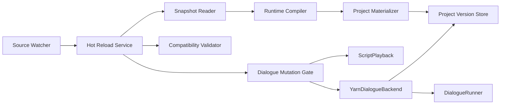
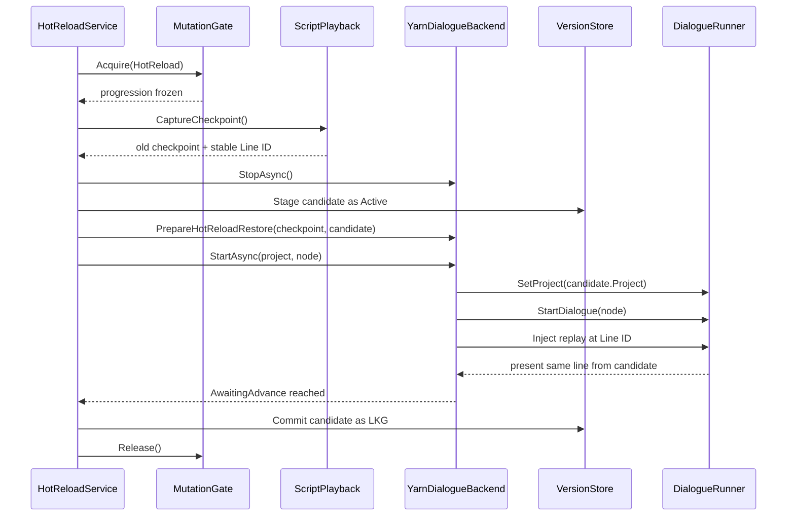

# Yarn Script Hot Reload 技术方案

状态：Implemented (MVP)
目标版本：Majo Runtime 开发期功能  
适用范围：Godot Editor、桌面 Debug Build；Release Build 默认且强制关闭

## 0. 当前实现与启用方式

运行时实现位于 `addons/majo_runtime/Runtime/Dialogue/Yarn/HotReload`，已包含：

- `.yarnproject` glob 快照、内容指纹和 torn-read 重试；
- 使用 YarnSpinner 3.2 runtime compiler 的内存编译；
- 独立内存 `YarnProject` materialization、Active/Running/LKG 版本边界；
- `FileSystemWatcher`、debounce、generation 淘汰和周期一致性扫描；
- `AwaitingAdvance` 安全点迁移、推进冻结、同 Line ID replay 和失败回滚；
- compile/apply/rollback 结构化日志与 `IYarnHotReloadService` 状态/事件；
- History、Voice、Played、AutoSave 和 Skip 的 `HotReloadReplay` 副作用抑制；
- 单元测试及真实 `DialogueRunner` headless 迁移测试。

在项目配置的 `Dialogue > Hot Reload` 中设置：

```text
Enabled = true
```

从 Godot Editor 运行时会监听 `Resources.RootPath/Resources.ScriptsPath`。桌面 Debug Export
还需要设置 `EnableInExportedDebugBuild = true`，并将 `SourceRootOverride` 指向外部源码目录。
Release Build 即使资源误设为启用也不会启动 watcher。

可通过运行时服务容器取得 `IYarnHotReloadService`，调用 `RequestReloadAsync` 手动编译，或订阅
`StatusChanged` / `AttemptCompleted` 构建自定义 Debug UI。当前默认 Debug Overlay 尚未提供
Compile/Discard 按钮；这部分仍属于后续编辑器体验增强，不影响自动热重载路径。

## 1. 背景

目前 Majo Runtime 已经具备实现 Yarn Script Hot Reload 所需的几个基础能力：

- `YarnDialogueBackend` 由 Runtime 创建并持有 `DialogueRunner`，宿主不直接管理 Yarn 会话。
- `ScriptPlayback` 能识别 `AwaitingAdvance` 等播放阶段。
- `YarnVmStateBridge` 能在稳定台词边界捕获 VM 状态，并在新会话选中节点后，从指定稳定 Line ID 重放。
- command 参数错误、资源缺失和未注册 command 已有可恢复错误策略，不会因为作者正在修改脚本而终止整个 Runtime。
- Actor、Audio、变量等 Runtime 状态独立于 Yarn VM，停止 Yarn 会话不会自动清空游戏状态。

但是，Godot Yarn 插件的 `DialogueRunner.SetProject` 明确禁止在 dialogue 正在运行时替换项目。因此 Hot Reload 不能通过原地修改当前 `Program` 实现，而必须执行一次受控的会话迁移。

## 2. 目标与非目标

### 2.1 目标

1. 保存 `.yarn` 后自动编译，不需要重启场景或 Runtime。
2. 编译失败时继续运行最后一个可用版本（last-known-good，以下简称 LKG）。
3. 编译成功且当前处于安全边界时，在不重复执行旧 command 的前提下切换到新 Program。
4. 当前台词仍存在时，重新显示它的新文本，下一次推进开始执行新脚本。
5. 当前状态不适合切换时排队，等待下一个安全边界。
6. 无法无缝迁移时保留旧会话，新版本在下一次 dialogue 启动时生效。
7. 编译错误、候选版本、应用结果和回滚结果都进入结构化日志及 Debug Inspector。
8. 文件连续保存、编辑器原子替换文件和编译耗时重叠时，永远只提交最新完整版本。

### 2.2 非目标

第一版不尝试：

- 在 command 正在执行、选项正在等待选择、节点跳转中或台词打字中迁移 VM。
- 让已经执行过的 command 因脚本修改而自动撤销或重放。
- 根据改动后的前文重新计算 Actor、Audio 或其他世界状态。
- 在 Release Build 中监听外部源码。
- 修改 YarnSpinner-Godot vendor 代码或依赖 Godot Editor importer 才能工作。
- 自动生成稳定 Line ID；只诊断隐式 ID，并提示作者补充 `#line:`。
- 在多个运行实例之间同步热更新。

## 3. 核心设计结论

采用“候选版本 + 安全点事务切换”，而不是修改已加载的 `YarnProject`：

```text
文件变化
  -> 获取一致的源码快照
  -> 后台编译候选版本
  -> 编译及兼容性预检
  -> 保存为 Ready Candidate
  -> 等待 AwaitingAdvance
  -> 冻结推进
  -> 捕获旧 VM checkpoint
  -> 停止旧会话
  -> 激活候选 YarnProject
  -> 从同一 Line ID 重放
  -> 成功：候选成为 LKG
  -> 失败：恢复旧 Project 和旧 checkpoint
```

有三个必须坚持的不变量：

1. **编译失败不触碰当前会话。** 编译只产生隔离的候选对象。
2. **候选成功运行到目标边界之后才成为 LKG。** “编译成功”不等于“应用成功”。
3. **任何时刻只有一个会话迁移事务。** Start、Stop、存档恢复、语言切换和 Hot Reload 必须共享同一 mutation gate。

## 4. 为什么不直接复用 Godot Import

Godot Editor 的 Yarn importer 会更新导入产物和 `YarnProject` Resource，但不适合作为 Runtime Hot Reload 的核心：

- importer 属于 Editor 生命周期，Debug Export 不一定存在。
- `ResourceLoader.CacheMode.Reuse` 和 Majo `ResourceManager` 都可能返回旧对象。
- `YarnProject.Program` 本身还会缓存反序列化后的 Program；修改同一个 Resource 的 Base64 字段并不能保证清除该缓存。
- importer 会写 `.godot/imported`、`.tres`、本地化 CSV 等磁盘产物，候选编译失败时很难做到真正的事务隔离。
- importer 事件和文件保存事件之间存在竞态，无法保证当前加载到的是哪一代内容。

因此 Hot Reload 编译器直接读取 `.yarnproject` 和 `.yarn`，生成一个新的、仅存在于内存中的 `YarnProject`。正常启动仍可使用导入后的 Godot Resource；启用 Hot Reload 后，由版本仓库决定返回导入版本还是内存版本。

## 5. 总体架构

建议增加以下组件：

| 组件 | 职责 | 是否接触 Godot API |
| --- | --- | --- |
| `IYarnSourceWatcher` | 监听源码目录，只产生“可能已变化”的提示 | 否 |
| `YarnSourceSnapshotReader` | 解析 manifest、展开 glob、读取一致源码快照、计算源码指纹 | 仅路径转换在主线程 |
| `IYarnRuntimeCompiler` | 从内存源码编译 `CompilationResult` 和诊断 | 否，可后台执行 |
| `YarnProjectMaterializer` | 将纯编译结果构造成全新的内存 `YarnProject` | 是，主线程 |
| `IYarnProjectVersionStore` | 保存 Imported、Candidate、Active、LKG 版本 | Resource 只在主线程访问 |
| `IYarnHotReloadService` | 去抖、代次合并、预检、排队、应用与回滚 | 编排器 |
| `IDialogueMutationGate` | 串行化会话级变更并冻结推进 | 是 |
| `IYarnReloadCompatibilityValidator` | 检查 Line ID、节点、变量和当前重放内容兼容性 | 否 |

依赖关系：



`YarnDialogueBackend` 不再直接把 `IResourceLoader<YarnProject>` 当作唯一来源，而是通过 `IYarnProjectVersionStore.GetActiveAsync(projectId)` 取当前版本。Store 首次访问时加载正常 Godot Resource，并将其登记为 Imported/LKG。

## 6. 数据模型与接口草案

以下接口表达边界，不要求实现时逐字照搬命名。

```csharp
public enum YarnHotReloadState
{
    Disabled,
    Watching,
    Debouncing,
    Compiling,
    PendingSafePoint,
    Applying,
    RollingBack,
    Faulted,
}

public enum YarnHotReloadOutcome
{
    Applied,
    ReadyForNextSession,
    NoSourceChange,
    CompileRejected,
    CompatibilityRejected,
    Superseded,
    RolledBack,
    Failed,
}

public enum DialoguePresentationOrigin
{
    Normal,
    CheckpointRestore,
    HotReloadReplay,
}

public sealed record YarnSourceFileSnapshot(
    string LogicalPath,
    string AbsolutePath,
    string Content,
    string ContentHash);

public sealed record YarnSourceSnapshot(
    string ProjectId,
    string ManifestPath,
    int LanguageVersion,
    string BaseLanguage,
    IReadOnlyList<YarnSourceFileSnapshot> Files,
    string SourceFingerprint);

public sealed record YarnCompilationDiagnostic(
    string Severity,
    string? Code,
    string File,
    int StartLine,
    int StartColumn,
    int EndLine,
    int EndColumn,
    string Message);

public sealed record YarnProjectVersion(
    long Generation,
    string ProjectId,
    string SourceFingerprint,
    string ProgramFingerprint,
    YarnProject Project,
    IReadOnlySet<string> NodeNames,
    IReadOnlySet<string> LineIds,
    IReadOnlyDictionary<string, YarnVariableSchema> Variables,
    IReadOnlyList<YarnCompilationDiagnostic> Diagnostics,
    DateTimeOffset CompiledAt);

public interface IYarnHotReloadService : IRuntimeService
{
    event Action<YarnHotReloadStatusChanged>? StatusChanged;
    event Action<YarnHotReloadAttempt>? AttemptCompleted;

    YarnHotReloadStatus Status { get; }

    Task RequestReloadAsync(
        string? projectId = null,
        CancellationToken cancellationToken = default);
}
```

`DialogueLine` 增加一个有默认值的 `Origin` 字段，保持现有调用方源码兼容：

```csharp
public sealed record DialogueLine(
    string Id,
    string? Speaker,
    DialogueText Text,
    IReadOnlyList<string> Metadata,
    string? ResolvedLocale = null,
    DialoguePresentationOrigin Origin = DialoguePresentationOrigin.Normal);
```

不要用全局布尔值表示“现在正在重放”。Origin 必须跟随具体 line 事件，否则异步 Presenter、History 和 Voice 可能在 scope 已退出后才处理事件。

## 7. 源码发现与一致性快照

### 7.1 Project ID 映射

默认映射规则与当前 Resource loader 保持一致：

```text
Resources.RootPath + Resources.ScriptsPath + ProjectId + ".yarnproject"
```

例如：

```text
RootPath       = res://demos/demo-01/assets
ScriptsPath    = scripts
ProjectId      = main
Manifest       = res://demos/demo-01/assets/scripts/main.yarnproject
```

路径先在 Godot 主线程调用 `ProjectSettings.GlobalizePath`，Watcher 和 Compiler 后续只处理绝对文件系统路径。

可选的 `SourceRootOverride` 仅用于 Debug Build，使运行中的导出包可以监听仓库源码。它必须是明确目录，不能在 Release 中启用，也不能允许脚本用 `..` 逃逸该目录。

### 7.2 Watcher 策略

使用混合策略：

- `FileSystemWatcher` 递归监听 `.yarn` 和 `.yarnproject` 的 Changed、Created、Deleted、Renamed。
- 事件只作为脏标记，不直接编译。
- 默认 debounce 250 ms；每次新事件重置计时。
- 每 2 秒进行一次轻量 manifest/source hash 校验，补偿 macOS 原子保存、Watcher buffer overflow 或漏事件。
- Watcher overflow 记录 warning，并立即安排一次全量 hash 校验。

只监听已启用项目的 Scripts root。第一版只自动编译 active project；非 active project 的变化记为 dirty，在它下一次启动前编译。这样可以避免大型项目每次保存都编译所有章节。

### 7.3 快照一致性

不能让 Yarn Compiler 自己再次从文件路径读取内容，否则保存过程中可能混入两个版本。正确流程是：

1. 读取 `.yarnproject`。
2. 展开 `sourceFiles` 和 `excludeFiles` glob，排序并去重。
3. 逐文件读取内容、长度和最后写入时间。
4. 全部读取后再次检查 manifest 及文件元数据。
5. 任一文件变化则短暂退避后重试，最多 3 次。
6. 对“逻辑路径 + UTF-8 内容”计算 SHA-256，得到 `SourceFingerprint`。
7. 通过 `CompilationJob.CreateFromInputs` 编译内存字符串，而不是 `CreateFromFiles`。

文件刚被 rename/delete 的短暂窗口视为可重试 IO 状态，不立即覆盖上一条编译诊断。

## 8. 编译流水线

### 8.1 线程边界

后台线程可以执行：

- 读取/哈希普通文件。
- 解析 `.yarnproject` JSON。
- 创建纯 .NET source inputs。
- `Yarn.Compiler.Compiler.Compile`。
- 整理诊断、节点、Line ID、变量 schema。

Godot 主线程执行：

- `ProjectSettings.GlobalizePath`。
- 创建 `YarnProject`、`Localization`、`LineMetadata` Resource。
- 调用 `DialogueRunner` 和 Presenter。
- 更新 Project Version Store 中会被 Godot 使用的 Active Resource。

`CompilationJob.CancellationToken` 使用每一代请求的 token。新文件变化到达时取消旧代；如果 compiler 已无法及时取消，旧代结果也必须在提交前通过 generation 检查并丢弃。

### 8.2 Compiler Library

Hot Reload 必须使用与正常 Yarn import 相同的函数声明 Library，否则正常导入成功的脚本可能在运行时编译失败。

新增 `IYarnCompilationLibraryProvider`：

- 默认提供 Yarn 内置函数以及 YarnSpinner-Godot Actions 注册的函数声明。
- Majo 自定义 Yarn function 通过 Bootstrap hook 注册。
- Yarn command 不需要成为编译期函数；未知 command 继续由现有 Runtime command 容错策略处理。

Library 在主线程初始化时构建不可变快照，Compiler 后台只读使用。

### 8.3 候选 Materialization

每次成功编译都创建全新的 `YarnProject`，绝不复用旧对象：

- 将 `CompilationResult.Program` 序列化到 `CompiledYarnProgramBase64`。
- 用 `CompilationResult.StringTable` 构建 base `Localization`。
- 用 StringTable metadata 构建 `LineMetadata`，过滤 `line:` 标签本身。
- 设置 base language、解析状态、空 error 列表及所需 declarations。
- 不设置持久 `ResourcePath`，不写 `.tres` 或 `.godot/imported`。

创建后立即读取一次 `Project.Program` 并计算 SHA-256，验证序列化往返一致；Program fingerprint 继续沿用当前 `YarnDialogueBackend.CreateDescriptor` 的算法。

### 8.4 编译诊断

所有 Yarn diagnostics 都保留，而不是只保留 error：

- Error：候选拒绝，当前 LKG 不变。
- Warning：候选可继续预检。
- Info：仅记录到 Debug Inspector。

同一 `SourceFingerprint` 的相同诊断只发布一次，避免轮询不断刷屏。新一代成功后清除 Debug Inspector 中“当前编译错误”状态，但历史结构化日志仍保留。

## 9. 版本仓库与 LKG 语义

每个 Project ID 保存：

```text
ImportedVersion  Godot importer 生成的启动版本
ActiveVersion    新会话当前应该使用的版本
RunningVersion   当前 DialogueRunner 正在执行的版本
ReadyCandidate   已编译但尚未成功应用的候选
LastKnownGood    最近一次成功启动/恢复到安全边界的版本
```

状态变化规则：

- 第一次正常加载后：Imported = Active = Running = LKG。
- dialogue Idle 时编译成功：Candidate 经静态预检后成为 Active；下一次成功启动时成为 LKG。
- dialogue Running 且可迁移：Candidate 先进入 Ready；迁移成功后 Active = Running = LKG = Candidate。
- 候选与当前边界不兼容：Candidate 可成为 `NextSessionVersion`，但 Running 和 LKG 保持旧版本。
- 应用失败并成功回滚：Active = Running = LKG = old，失败 Candidate 被隔离。
- 下一代源码到达时替换未应用 Candidate。

`ResourceManager` 不负责热更新失效。Yarn 版本仓库是 Yarn Program 的唯一版本边界，避免给通用资源缓存增加特殊语义。

## 10. 安全点定义

MVP 唯一允许实时迁移的边界是：

```text
ScriptPlayback.Phase == AwaitingAdvance
&& ScriptPlayback.CanCaptureCheckpoint
&& CurrentSpot != null
&& 没有活跃 command
&& 没有其他 dialogue mutation
```

各阶段处理：

| 当前阶段 | 行为 |
| --- | --- |
| `Idle` | 激活候选，下一次 Start 使用 |
| `Loading` | 排队，当前 Start 完成后重新判断 |
| `Executing` | 排队，避免重复或跳过 command |
| `PresentingLine` | 排队，等打字完成进入 AwaitingAdvance |
| `AwaitingAdvance` | 获取 mutation gate 后立即尝试应用 |
| `PresentingOptions` | 排队；本版不迁移 pending option VM 状态 |
| `Stopping` | 排队到 Idle |
| `Faulted` | 只登记 NextSessionVersion，不自动重启 |

如果 Auto/Skip 模式开启，`AwaitingAdvance` 可能很短。`IDialogueMutationGate` 必须和 phase 变化同步取得推进冻结权；不能仅启动一个普通异步 Task，再期望 Auto 不会先调用 `RequestNextLine`。

Gate 持有期间：

- `RequestNextLine` 不进入 Yarn VM。
- Auto/Skip deadline 暂停。
- 用户推进输入被消费但不排队，避免 reload 后意外跳过新文本。
- Save/Load、New Game、Locale session mutation 等操作等待同一 gate。
- `RequestHurryUp` 不再转发，因为当前行已经完整显示。

## 11. 兼容性预检

编译成功后、停止旧会话前执行预检。失败只意味着不能实时迁移，不影响旧会话。

### 11.1 必须满足

1. 当前 Project ID 与候选 Project ID 一致。
2. 当前 node 在候选 Program 中存在。
3. 当前 Line ID 在候选项目中全局唯一，且属于当前 node。
4. checkpoint 边界为 `AwaitingLineAdvance`。
5. 当前 Line ID 是显式稳定 ID，而不是 compiler 生成的 implicit tag。
6. 当前 substitutions 能用于展开候选台词；展开或 markup parse 不能抛错。
7. 当前已存储变量若仍在候选中声明，其 Yarn 类型必须兼容。
8. 候选 Program 能被新的 `YarnProject.Program` 正常反序列化。

### 11.2 允许但告警

- 删除当前未使用的变量：保留 VariableStore 中的孤立值，后续不会被新 Program 读取。
- 添加新变量：未赋值时使用候选 Program 的初始值。
- 修改当前行之前的文本或 command：不会追溯执行。
- 修改当前行之后的控制流：下一次推进后立即生效。
- 增删其他 node：只要当前 node/line 仍可定位即可。

### 11.3 不兼容时的策略

候选标记为 `ReadyForNextSession`，当前会话继续使用旧 RunningVersion。记录精确原因，例如：

```text
Current line 'line:trial-014' no longer exists in node 'Trial'.
Live apply was skipped; generation 42 will be used by the next dialogue session.
```

不自动从 node 开头重启，因为这会重复执行 command 和剧情变量写入。Debug API 可以另行提供明确的“Restart current node with candidate”操作，但必须由开发者主动触发。

## 12. 应用事务

### 12.1 正常路径



具体顺序：

1. 获取 `IDialogueMutationGate`，二次确认 generation 和安全点。
2. 捕获旧 `ScriptCheckpoint`、OldVersion、变量快照、播放模式和当前 locale。
3. 标记下一条 replay line 的 `Origin = HotReloadReplay`。
4. `StopAsync`，沿用已有 command drain、Presenter quiescence 和双帧隔离。
5. Version Store 暂存 Candidate 为 Active，但尚不更新 LKG。
6. 将 `variableStore.Program` 指向候选 Program；已存储变量值不清空。
7. `Runner.SetProject(candidate.Project)`。
8. 从旧 checkpoint 的 node 启动，并通过 `YarnVmStateBridge` 注入到同一 Line ID。
9. 等待 `ScriptPlayback` 再次到达同一 `AwaitingAdvance` 边界，并设定超时。
10. 成功后提交 Candidate 为 Running/Active/LKG，发布 Applied 事件。
11. 恢复 Auto/Skip 状态，释放 gate。

Hot Reload checkpoint 与存档 checkpoint 的验证策略不同：存档恢复要求 Program fingerprint 完全一致；Hot Reload 恰恰是在跨 fingerprint 迁移，所以必须新增专用 `ValidateReloadTarget`，不能放宽现有存档校验。

### 12.2 Replay 的下游语义

重新显示当前台词会再次经过 Presenter，但它不是一条新的剧情记录：

- Default dialogue UI：立即替换当前文本，不播放第二次 typewriter 动画。
- Voice Presenter：默认不重新播放当前 Voice。
- History：若最后一项 Line ID 相同，则原位更新文本、speaker、locale 和 voice 信息，保留 sequence；不追加重复项。
- Played Register：保持已读状态，不因技术重放改变“首次读到”的判断。
- Auto Save：不创建新的 auto-save candidate。
- Auto/Skip：迁移期间暂停；成功后按迁移前模式重新计算 deadline。
- 外部 `LinePresented` 订阅者：可以通过 `DialogueLine.Origin` 明确识别重放。

如果需要作者查看新的打字或 Voice 效果，应推进到下一行或使用显式 Debug restart，而不是让基础 Hot Reload 隐式重复副作用。

### 12.3 回滚路径

应用期间下列任一步骤失败都触发回滚：

- `SetProject` 或 `StartDialogue` 失败。
- VM bridge 无法找到目标 instruction。
- replay 未在超时内到达同一 Line ID。
- Presenter 在启动/显示时抛出异常。
- generation 在事务开始前已过期。

回滚流程：

1. 保持 mutation gate。
2. 尽力停止候选会话并等待 Presenter/command quiescence。
3. 恢复 OldVersion 为 Active。
4. 恢复旧变量快照；这可以清除候选 Program 初始化过程中可能引入的值。
5. 设置旧 `variableStore.Program` 和旧 `YarnProject`。
6. 使用旧 checkpoint 和现有严格 fingerprint 校验恢复旧会话。
7. 到达旧 Line ID 的 `AwaitingAdvance` 后，恢复播放模式并释放 gate。
8. Candidate 标记 Failed，LKG 保持 OldVersion。

候选 Program 在 VM bridge 注入完成前不会执行它的 command，因此正常情况下回滚不会遇到候选副作用。若回滚本身失败，Dialogue 进入 Faulted，发布一个同时包含 apply exception 与 rollback exception 的 `AggregateException`；Runtime 其他服务保持运行。

## 13. 并发、去抖和代次规则

Hot Reload Service 使用单消费者循环，任何来源只调用 `MarkDirty(projectId)`：

```text
requestedGeneration++
cancel current debounce/compile
signal worker
```

Worker 规则：

1. 每个 Project ID 最多一个 compile in flight。
2. 读取快照前等待 debounce。
3. `SourceFingerprint == Active/Ready fingerprint` 时返回 NoSourceChange。
4. 编译结束时若 generation 不是最新，结果标记 Superseded，禁止 materialize/apply。
5. Ready Candidate 等待安全点期间如果出现新代，旧 Candidate 直接替换。
6. Apply 已经取得 mutation gate 后不在中途取消；完成应用或回滚，随后立即处理最新代。
7. Shutdown 先停止 Watcher，再取消 worker，最后等待 apply/rollback 离开 gate。

这样可以避免快速按三次保存时短暂应用中间坏版本。

## 14. 配置建议

在 `DialogueConfiguration` 增加嵌套 Resource 或独立 `YarnHotReloadConfiguration`：

```csharp
[GlobalClass]
public partial class YarnHotReloadConfiguration : Resource
{
    [Export] public bool Enabled { get; set; }
    [Export] public int DebounceMilliseconds { get; set; } = 250;
    [Export] public int ConsistencyScanMilliseconds { get; set; } = 2000;
    [Export] public int ApplyTimeoutMilliseconds { get; set; } = 3000;
    [Export] public bool EnableInExportedDebugBuild { get; set; }
    [Export] public string SourceRootOverride { get; set; } = string.Empty;
}
```

启用条件：

```text
Enabled
&& OS.IsDebugBuild()
&& (OS.HasFeature("editor") || EnableInExportedDebugBuild)
```

不能使用 `Engine.IsEditorHint()` 判断“从 Editor 启动的游戏”：游戏进程执行场景时该值通常为 false；这里需要判断当前 Godot 可执行文件是否带 `editor` feature。

Release Build 即使 Resource 中误设 Enabled 也不启动 Watcher，并记录一次 info 而非 error。

建议默认值：

- Editor：允许启用，默认关闭，Demo 开发配置可打开。
- Debug Export：默认关闭，需要显式打开并配置外部 SourceRoot。
- Release：强制关闭。

## 15. 结构化日志与 Debug UI

日志 category 使用 `script.hot_reload`，建议事件：

| Event ID | Level | 含义 |
| --- | --- | --- |
| `script.hot_reload.watching_started` | Info | Watcher 已启动 |
| `script.hot_reload.change_detected` | Debug | 文件变化已合并到某一代 |
| `script.hot_reload.compile_started` | Debug | 开始编译源码快照 |
| `script.hot_reload.compile_succeeded` | Info | 候选编译成功 |
| `script.hot_reload.compile_failed` | Error | 编译失败，LKG 继续运行 |
| `script.hot_reload.pending_safe_point` | Info | 候选等待安全点 |
| `script.hot_reload.live_apply_rejected` | Warning | 当前边界不兼容，留待下次会话 |
| `script.hot_reload.apply_started` | Info | 开始事务切换 |
| `script.hot_reload.applied` | Info | 候选已成为 LKG |
| `script.hot_reload.rollback_started` | Warning | 应用失败，开始回滚 |
| `script.hot_reload.rolled_back` | Error | 已恢复 LKG，Runtime 继续运行 |
| `script.hot_reload.rollback_failed` | Error | 回滚也失败，Dialogue Faulted |
| `script.hot_reload.watcher_overflow` | Warning | Watcher 丢事件，安排全量扫描 |

每条日志 properties 至少包含：

```text
projectId, generation, sourceFingerprint, programFingerprint,
changedFiles, currentNode, currentLineId, playbackPhase,
elapsedMilliseconds, outcome
```

编译诊断另带 file、range、severity、diagnosticCode。路径显示为项目内逻辑路径，不在普通日志暴露用户绝对目录。

Debug Inspector 增加 Hot Reload 区域：

- 当前状态与 generation。
- Running/LKG/Candidate fingerprint 的短值。
- 最后检测时间、编译耗时、应用耗时。
- Pending 原因和当前安全点。
- 最新 diagnostics，可点击时跳转 `file:line:column`。
- `Compile now`、`Apply at next safe point`、`Discard candidate` 三个开发按钮。

第一版不需要 toast；编译失败时保持游戏可操作，并在 Debug Inspector 和 Godot console 显示错误即可。

## 16. 与现有系统的集成修改

### 16.1 `YarnDialogueBackend`

- 注入 `IYarnProjectVersionStore`，替代直接把 Resource loader 当作唯一加载来源。
- 暴露仅供 session coordinator 使用的项目切换/重放入口，不让 UI 直接操作 Runner。
- `PrepareRestore` 拆分为普通 checkpoint restore 和 hot reload restore，两者验证策略不同。
- replay 时给转换后的 `DialogueLine` 设置 `Origin`。
- `RequestNextLine` 接入 mutation gate。
- 当前 RunningVersion 进入 `ScriptDescriptor`，避免 Resolve 误读 ResourceManager 的旧缓存。

### 16.2 `ScriptPlayback`

- 保持现有 checkpoint API 的严格 fingerprint 语义。
- 对 Hot Reload Service 暴露 phase/spot 通知以及内部等待指定边界的可复用方法。
- Start/Stop/Restore 与 Hot Reload 使用同一个 `IDialogueMutationGate`。
- 迁移导致的内部 Stop/Start 不应对上层伪装成玩家主动停止；增加 mutation-aware completion suppression。

### 16.3 `DialoguePlayer`

当前 `StopAsync`/`StartAsync` 会改变公开 session 状态并触发 Completed/Stopped。Hot Reload 不应该让业务层看到一次完整会话结束。因此建议把迁移放在 backend/session coordinator 内，并增加内部 `ReplaceRunningProgramAsync` 操作；它维持同一个 `CurrentDialogueSessionId`，只发布 Hot Reload 状态事件。

若第一版为了复用现有方法而发生内部 Stop/Start，则必须在 `DialoguePlayer` 增加 mutation scope，抑制内部 `Stopped`/`Completed`，否则 History、AutoSave 和业务逻辑会误判剧情结束。

### 16.4 History、Played、Save、Voice、Auto

所有按 line 驱动的服务检查 `DialogueLine.Origin`：

- History 对 `HotReloadReplay` 更新最后一项。
- Played 不重置首次阅读判断。
- SaveProductManager 不因 replay 建立新的边界或触发 auto save。
- Voice presenter 默认跳过 replay。
- PlaybackModeManager 在 mutation gate 期间持有新的 `PlaybackPauseReason.HotReload`。

### 16.5 Bootstrap 与生命周期

建议注册顺序：

```text
Yarn compiler/library provider
-> Project version store
-> Yarn backend / DialoguePlayer / ScriptPlayback
-> Mutation gate
-> Hot Reload Service
-> Debug Inspector projection
```

Hot Reload Service 应在依赖的 dialogue 服务之后初始化，在它们之前 shutdown。Watcher 回调不得捕获已释放的 Bootstrap Node。

## 17. 建议文件布局

```text
addons/majo_runtime/Runtime/Dialogue/Yarn/HotReload/
├── IYarnHotReloadService.cs
├── YarnHotReloadModels.cs
├── YarnHotReloadService.cs
├── YarnSourceWatcher.cs
├── YarnSourceSnapshotReader.cs
├── YarnRuntimeCompiler.cs
├── YarnProjectMaterializer.cs
├── YarnProjectVersionStore.cs
├── YarnReloadCompatibilityValidator.cs
└── DialogueMutationGate.cs

addons/majo_runtime/Runtime/Configuration/
└── YarnHotReloadConfiguration.cs
```

不要把核心逻辑放进 `addons/YarnSpinner-Godot/Editor`，也不要直接修改 vendor 的 `YarnProjectEditorUtility`。如需复用 string table/metadata 转换，应在 Majo 目录实现小型、可单测的转换器。

## 18. 测试策略

### 18.1 单元测试

Compiler/Snapshot：

- manifest glob 和 exclude 正确展开。
- 文件排序不同不会改变 source fingerprint。
- 内容变化一定改变 fingerprint。
- 保存中途元数据变化会重试，不产生 torn snapshot。
- 新 generation 取消或淘汰旧 compilation。
- error diagnostics 不生成 Candidate。
- warning diagnostics 允许 Candidate。
- 相同错误不会被轮询重复发布。

Version Store：

- Candidate 在 apply 成功前不是 LKG。
- 失败 Candidate 不污染 Active/Running。
- Ready Candidate 被更新代正确替换。
- ResourceManager 的旧 imported cache 不覆盖内存 ActiveVersion。

Compatibility：

- 当前 node/line 保留时通过。
- 当前 line 删除、改 ID、移动到其他 node 时拒绝 live apply。
- implicit Line ID 拒绝 live apply。
- 重复 Line ID 拒绝。
- substitution/markup 不兼容拒绝。
- 变量同类型、新变量通过；变量类型变化拒绝。

Coordinator：

- Idle 时只切换下一次启动版本。
- PresentingLine/Executing/Options 时只排队。
- AwaitingAdvance 时获取 gate 并迁移。
- apply 期间用户推进不会进入 VM。
- 编译失败时当前 completion、line、actors、variables 不变。
- apply 失败会恢复旧 LKG。
- rollback 失败只 fault dialogue，不停止 Runtime Host。
- shutdown 正确取消 watcher/compile，并等待 transaction 结束。

### 18.2 Godot Headless 集成测试

使用临时源码目录和真实 `DialogueRunner`：

1. 启动 V1，停在 `line:hot-reload-current`。
2. 将 V2 写入临时 `.yarn`，修改当前文本和下一条控制流。
3. 等待 Applied。
4. 断言仍停在同一 Line ID，显示 V2 文本。
5. 推进后断言走 V2 的下一行。
6. 断言当前行之前的 command 没有重复执行。
7. 断言 History 没有重复项、Voice 没有重播、AutoSave 没有多提交。
8. 断言 dialogue session ID 保持不变。

额外场景：

- 写入语法错误：收到 compile_failed，V1 仍可继续。
- 错误修正为 V3：V3 正常应用。
- 删除当前 Line ID：当前 V1 会话继续，V3 在下一次 Start 生效。
- Options 阶段保存：候选等待；选择后在下一个台词边界应用。
- Auto/Skip 模式：不会在迁移过程中越过目标行。
- Apply 人工注入异常：自动回滚并继续 V1。
- 高频保存 10 次：只应用最后一代。
- 文件 rename/atomic save：Watcher 和 consistency scan 最终检测到。

### 18.3 可见 Demo 验收

在 Runtime Demo Debug Panel 显示当前 generation。在目标台词停住后：

- 修改正文并保存，画面原位更新。
- 添加下一条台词并推进，可以立即读到。
- 输入错误语法，画面不消失、Runtime 不停止，并显示定位诊断。
- 修复语法，再次保存后无需重启即可继续。
- 修改当前 `#line:`，面板提示“next session only”，当前会话不被中断。

## 19. 性能与资源约束

- 正常帧不扫描源码内容；一致性扫描只比较已知文件元数据，变化后才读取和哈希。
- Compiler 在后台执行，主线程只 materialize 和 apply。
- Store 默认每项目保留 Imported、LKG 和至多一个 Candidate；旧内存 `YarnProject` 在确认无 Runner/LineProvider 引用后释放。
- 大型项目后续可按 Yarn project 拆分；第一版仍采用 project 全量编译，因为 Yarn compiler 的跨文件声明和节点引用要求一致 Program。
- 记录 compile 和 apply 时间。建议目标：普通项目 save-to-diagnostic 小于 500 ms，save-to-applied 小于 1 s；不把硬实时阈值写进功能正确性测试。

## 20. 安全与发布策略

- Release 强制禁用 Watcher、绝对源码路径和 Debug 编译入口。
- `SourceRootOverride` 经过 canonicalize 后必须位于显式允许目录。
- 日志默认只输出逻辑相对路径。
- Hot Reload 不写用户 Yarn 源码、不自动补标签、不更新 importer 产物。
- 编译器异常当作候选失败处理，不传播到 Runtime Host 生命周期。
- 非 recoverable Runtime command/programming error 仍按现有策略 fault 当前 dialogue；Hot Reload 不扩大错误吞噬范围。

## 21. 分阶段实施计划

### Phase A：可编译候选与 LKG（基础层）

- 增加配置、源码快照、后台 compiler、materializer 和 version store。
- 只支持 Idle/Next Session 生效。
- 接入结构化 diagnostics 和手动 `RequestReloadAsync`。
- 完成纯单元测试。

验收：语法错误不会替换启动版本；修复后下一次 Start 使用新版本。

### Phase B：安全点实时迁移（核心层）

- 实现 mutation gate。
- 增加专用 reload compatibility validator。
- 扩展 Backend/VM bridge，跨 fingerprint 恢复到同一 Line ID。
- 完成 apply/rollback 事务和 headless tests。

验收：停在稳定台词时修改当前/后续文本，可以不中断 Runtime 地切到新版本；失败自动回滚。

### Phase C：副作用幂等与自动监听（体验层）

- 增加 `DialoguePresentationOrigin`。
- 调整 History、Played、Save、Voice、Auto/Skip。
- 加入 Watcher、debounce、generation 和一致性扫描。
- 接入 Debug Inspector 和可见 Demo。

验收：真实编辑器连续保存体验稳定，无重复 History、Voice、AutoSave 或 command。

### Phase D：增强项（非 MVP）

- 显式 Debug 操作：从 node 开头重启候选版本。
- 支持 Options boundary 的候选迁移，需要捕获 pending option IDs 和选择状态。
- 对多个 Project ID 建依赖索引并增量调度编译。
- 与外部 Yarn 编辑器诊断跳转集成。
- 可选的 current-line voice/typewriter replay 策略。

## 22. 完成定义

功能只有同时满足以下条件才算完成：

1. 语法错误连续存在时，运行中的 LKG 会话可以继续推进并完成。
2. 修复脚本后，当前稳定 Line ID 能迁移到新 Program，且后续执行新控制流。
3. 应用失败可以恢复旧 Program、变量和当前 Line ID。
4. 当前行之前的 command 不会重复执行。
5. History、Played、Voice、AutoSave 不产生技术重放副作用。
6. Auto/Skip 和用户输入不能抢跑 mutation transaction。
7. 快速连续保存只会提交最新代。
8. Headless、可见 Demo、unit tests 和 `tools/test.sh --fast` 全部通过。
9. Release Build 不启动文件监听，也不暴露源码绝对路径。

## 23. 最终建议

第一版应严格限定在“稳定 Line ID + AwaitingAdvance”这一条可靠路径。它覆盖实际写剧本时最常见的工作流：作者停在当前句，修改当前或后续内容，保存，然后继续阅读。

不要为了看起来更“实时”而在任意 VM instruction 上迁移。Yarn command 可能已经修改 Actor、Audio、变量或存档状态，任意位置重启无法同时保证不重复副作用和不跳过逻辑。把不兼容候选安全地延迟到下一次 session，比猜测恢复位置更符合 Runtime 的可预测性目标。
