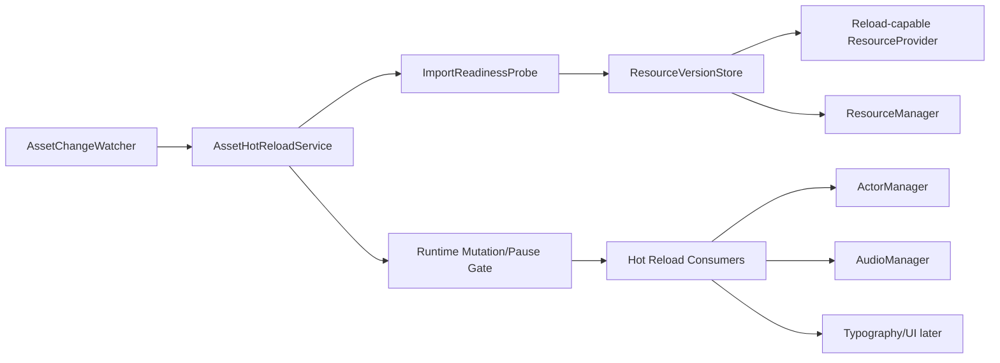
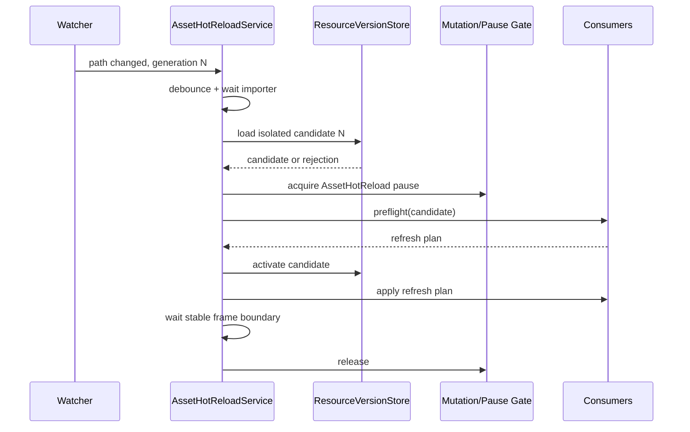

# Asset Hot Reload 技术方案

状态：Draft  
目标：在 Godot Editor/Debug 开发期，安全地更新 Majo Runtime 引用的图片、音频及部分 UI 资源  
与 Yarn Hot Reload 的关系：独立服务，共享 Runtime mutation/pause 边界，但不重新执行 Yarn command

## 0. 结论与复杂度

整体复杂度为中高，建议拆成两个能力交付：

1. **Next-use reload**：同路径资源保存后，下一次加载能够取得新对象。
2. **Live rebind**：已经显示或正在使用该资源的 Runtime consumer 主动换用新对象。

第一项主要改造资源缓存，边界清楚；第二项必须分别定义 Texture、Audio、Font、Theme、Scene
的运行中替换语义，不能用一个通用 `Reload()` 粗暴处理。

推荐 MVP 只支持：

- Texture2D next-use reload；
- 当前 Character/Background appearance 的无动画 live rebind；
- AudioStream next-use reload；
- 当前 BGM、Voice、SFX 不自动重启；
- 加载失败保留 Last Known Good asset；
- PackedScene、Shader、Theme、Font 的 live rebind 延后。

## 1. 目标

- 监听项目内允许的 Asset 源文件变化。
- 避免 Majo `ResourceManager` 和 Godot `ResourceLoader` 返回旧缓存对象。
- 同一路径的新版本与仍被使用的旧版本可以短暂共存。
- 新版本加载、类型检查或应用失败时，当前画面和声音不受影响。
- 当前 Actor 可以在保持位置、透明度、可见性、层级和动画状态的情况下刷新贴图。
- Asset reload 与 Yarn reload、Save/Load、New Game、Locale mutation 不并发修改 Runtime。
- Debug Overlay 和结构化日志能说明 detected、waiting、applied、rejected、superseded。

## 2. 非目标

MVP 不处理：

- Release Build 运行时换资源；
- 任意外部目录资源直接注入导出包；
- 自动重新执行 Yarn 中当前行以前的 `char`、`back`、`bgm` command；
- 在运行中整体替换任意 `PackedScene` 实例；
- 保持音频播放进度的无缝 AudioStream 替换；
- Shader、Material、Theme 任意依赖图的递归刷新；
- 修改 Actor/Audio 的配置定义后自动重建服务容器。

## 3. 为什么不能只清空 Dictionary

当前资源链路存在两层缓存：

```text
Majo ResourceManager cache
        -> GodotProjectResourceProvider
        -> Godot ResourceLoader cache (CacheMode.Reuse)
```

只从 `ResourceManager.loaded` 删除条目仍可能从 Godot `ResourceLoader` 取回同一个旧对象。
直接用 `CacheMode.Replace` 原地替换也不安全：旧对象可能正被 Actor、Audio backend、预加载 lease
或用户代码持有，原地改变会绕过 consumer 的事务边界。

因此资源缓存需要从“每个 CacheKey 一个对象”升级为“每个 CacheKey 一个 Active generation，旧
generation 可在引用释放前继续存在”。

## 4. 支持层级

| 层级 | 能力 | MVP |
| --- | --- | --- |
| L0 Detect | 检测文件变化并生成 generation | 是 |
| L1 Refresh-on-next-use | 后续 `Load/LoadAsync` 返回新资源 | 是 |
| L2 Live rebind | 当前 consumer 主动切换到新资源 | Texture2D only |
| L3 Structural reload | 重建 Scene、Theme、Shader 依赖图 | 否 |

## 5. Asset 类型语义

| 类型 | Next-use | Live rebind | MVP 规则 |
| --- | --- | --- | --- |
| Texture2D | 是 | 是 | 当前 Actor 重新绑定同 appearance 的新 Texture |
| AudioStream | 是 | 否 | 当前播放保持旧 stream；下一次播放使用新 stream |
| Font | 后续 | 后续 | 需要更新 FontCatalog 并重新 ApplyTypography |
| Theme | 后续 | 后续 | 需要重新投影到所有 Runtime UI root |
| Shader/Material | 后续 | 否 | 依赖和实例共享关系复杂，不自动刷新 |
| PackedScene | 后续 | 否 | 已实例化 Node 不自动替换 |
| 外部本地化文件 | 独立方案 | 独立方案 | 不混入 Asset MVP |

### 5.1 Texture2D

当前 Actor live rebind 必须保留：

- Actor ID、factory type；
- appearance ID 与 target appearance；
- position、scale、z-index；
- opacity、visibility；
- Background slot；
- layered character 当前 layer composition。

刷新不重新执行剧情 command，不触发 show/hide/crossfade，不写 History/Played/Save。

### 5.2 AudioStream

- 当前 BGM 不重启，避免播放位置跳回开头。
- 当前 Voice/SFX 不替换，避免重复语音或音效。
- 新的 `PlayBgmAsync`、`PlayVoiceAsync`、`PlaySfxAsync` 取得新 generation。
- Debug Overlay 可提供显式“Restart current BGM with latest asset”，但不属于自动路径。

### 5.3 PackedScene 与 Theme

运行中替换 scene 需要迁移 Node 状态、signal、输入 scope、service 引用和用户脚本状态，风险远高于
贴图替换。MVP 只记录资源已变化，并提示 restart required。

## 6. 总体架构



建议组件：

| 组件 | 职责 |
| --- | --- |
| `IAssetChangeWatcher` | 监听允许目录，规范化路径，产生 change hint |
| `IAssetImportReadinessProbe` | 等待 Godot importer 完成并验证可加载性 |
| `IResourceInvalidationService` | 将逻辑 key/解析路径标记为 stale |
| `IResourceVersionStore` | 管理 Active、Candidate、LKG 和退休 generation |
| `IAssetHotReloadConsumer` | 对某类 live object 做 preflight/apply/rollback |
| `IAssetHotReloadService` | generation 合并、事务编排、状态和日志 |

## 7. 数据模型草案

```csharp
public enum AssetHotReloadState
{
    Disabled,
    Watching,
    Debouncing,
    WaitingForImport,
    LoadingCandidate,
    PendingSafePoint,
    Applying,
    WatchingRestartRequired,
    RollingBack,
}

public enum AssetHotReloadOutcome
{
    Applied,
    RefreshedForNextUse,
    RestartRequired,
    UnsupportedType,
    ImportRejected,
    LoadRejected,
    Superseded,
    RolledBack,
}

public sealed record ResourceInvalidationRequest(
    string ResolvedPath,
    Type ResourceType,
    long Generation);

public sealed record ResourceVersionChanged(
    string ResolvedPath,
    Type ResourceType,
    long PreviousGeneration,
    long CurrentGeneration,
    object Resource);
```

资源版本条目至少包含：

```text
CacheKey
Generation
Resource object
State: Candidate | Active | Retired | Rejected
LeaseCount
PinnedLeaseCount
LoadedAt
SourceFingerprint / imported fingerprint
```

## 8. ResourceManager 改造

### 8.1 新接口

```csharp
public interface IResourceInvalidationService
{
    ResourceInvalidationResult InvalidateResolvedPath(
        string resolvedPath,
        long generation);

    Task<ResourceCandidate<TResource>> LoadCandidateAsync<TResource>(
        ResourceKey key,
        string? overridePath,
        long generation,
        CancellationToken cancellationToken = default)
        where TResource : class;

    void Activate<TResource>(ResourceCandidate<TResource> candidate)
        where TResource : class;

    void Reject(IResourceCandidate candidate);
}
```

`Invalidate` 不销毁旧对象，只做以下事情：

1. 标记当前 entry 为 stale/LKG。
2. 后续普通 Load 不再命中 stale entry。
3. candidate 使用 bypass-cache provider 路径加载新对象。
4. candidate 验证成功后成为 Active。
5. 旧 entry 在 lease/reference owner 释放后退休。

### 8.2 Godot provider

为 provider 增加显式 reload API，不能继续固定使用 `CacheMode.Reuse`：

```csharp
Task<object> ReloadAsync(
    ResourceLocation location,
    Type resourceType,
    CancellationToken cancellationToken);
```

候选加载应取得独立对象，避免在 commit 前修改旧对象。具体采用 `Ignore`、`IgnoreDeep` 或带版本
临时路径的策略，需要用 Godot headless 测试验证 Texture2D、AudioStream 及其 subresource 行为后确定。

### 8.3 Lease 和 pinned resource

- pinned/leased 旧版本允许继续使用。
- 新 Load 获取 Active 新版本。
- 旧 lease Release 只减少对应 generation 的计数。
- 不能沿用当前 `CacheKey -> CacheEntry` 单条结构，否则新旧 lease 会计到错误对象。
- cache budget 统计所有尚未退休的 generation。

## 9. 文件检测与 importer 边界

### 9.1 Editor MVP

第一版只支持 Godot Editor 内的 `res://` 项目资源：

- 监听配置允许的 Asset 根目录；
- 默认扩展名：png、jpg、webp、svg、wav、ogg、mp3；
- changed/created/renamed 只产生 change hint；
- debounce 后等待 importer 产物稳定；
- 连续变化只提交最新 generation。

不能在文件 Changed 事件后立即 Load，因为 watcher 可能早于 Godot importer 完成。Readiness probe 至少要：

1. 等待源文件 size/mtime 连续两次稳定；
2. 等待 `ResourceLoader.Exists(path, type)`；
3. 尝试隔离加载 candidate；
4. candidate type 和基本可用性验证成功；
5. 超时则 reject，LKG 不变。

### 9.2 Debug Export

Debug Export 没有稳定 Editor importer 生命周期。MVP 不承诺从外部源码目录导入任意 Asset。
后续若支持，需要独立 runtime decoder，例如 Image.Load + ImageTexture、AudioStreamWav decoder，不能直接
复用 Yarn 的 `SourceRootOverride` 语义。

## 10. 应用事务



事务规则：

1. Candidate load 失败不触碰 Active/LKG。
2. Consumer preflight 必须无副作用。
3. 先准备所有新对象，再切换 consumer。
4. 任一 live consumer apply 失败时：
   - next-use Active 是否回滚由策略决定；MVP 选择整体回滚；
   - 已切换 consumer 恢复旧引用；
   - 旧对象在事务完成前不得退休。
5. 成功后等待至少一个 process frame，再发布 `Applied`。

## 11. 与 Yarn Hot Reload 的关系

两个服务彼此独立：

- Yarn watcher 只处理 `.yarn`、`.yarnproject`。
- Asset watcher 只处理配置允许的资源扩展名。
- 二者使用不同 generation 和 LKG。
- 二者共享 mutation/pause gate，不能同时 apply。
- Asset reload 不触发 `HotReloadReplay`，也不重新执行 Yarn command。

例如当前 Actor appearance 为 `maya/angry`：

- 修改 `angry.png`：Asset consumer 可以直接给 Actor 重绑新 Texture。
- 修改 Yarn command `appearance:angry` 为 `appearance:shocked`：由 Yarn reload 更新后续 Program；
  不追溯执行该 command。

## 12. 配置草案

```csharp
[GlobalClass]
public partial class AssetHotReloadConfiguration : Resource
{
    [Export] public bool Enabled { get; set; }
    [Export] public string[] WatchRoots { get; set; } = [];
    [Export] public string[] Extensions { get; set; } =
        ["png", "jpg", "webp", "svg", "wav", "ogg", "mp3"];
    [Export] public int DebounceMilliseconds { get; set; } = 250;
    [Export] public int ImportTimeoutMilliseconds { get; set; } = 5000;
    [Export] public bool RefreshVisibleTextures { get; set; } = true;
    [Export] public bool RefreshAudioOnNextUse { get; set; } = true;
}
```

约束：

- Editor 可显式启用，默认关闭。
- Debug Export 默认关闭。
- Release 强制关闭。
- WatchRoot canonicalize 后必须位于项目或明确允许的外部目录。

## 13. 诊断

建议事件：

```text
asset.hot_reload.change_detected
asset.hot_reload.waiting_for_import
asset.hot_reload.candidate_loaded
asset.hot_reload.pending_safe_point
asset.hot_reload.applied
asset.hot_reload.next_use_only
asset.hot_reload.restart_required
asset.hot_reload.rejected
asset.hot_reload.rolled_back
asset.hot_reload.superseded
```

日志 properties：

- logicalKey；
- resolvedPath（日志中使用项目相对路径）；
- resourceType；
- generation；
- source/import fingerprint；
- affected consumer IDs；
- outcome；
- elapsed。

Debug Overlay 显示最近一次状态、受影响 Actor、是否只在 next-use 生效以及是否需要 restart。

## 14. 测试矩阵

### 14.1 ResourceManager 单元测试

- invalidate 后普通 Load 不返回旧 entry；
- candidate 失败保留 LKG；
- generation N+1 supersede N；
- 同路径不同 type 不互相失效；
- 旧 leased generation 与新 Active generation 共存；
- pinned 旧版本在 release 前不回收；
- cache budget 正确统计多 generation；
- shutdown 会释放 candidate 和 retired entry。

### 14.2 Godot provider headless 测试

- 修改同路径 PNG 后隔离加载得到不同 Texture 对象和像素；
- 修改 WAV/OGG 后 next-use 得到新 AudioStream；
- importer 尚未完成时不会提交半成品；
- 损坏图片/音频保留旧对象；
- 连续保存只应用最后 generation。

### 14.3 Live consumer headless 测试

- 当前 Character texture 更新但 transform/opacity/visibility 不变；
- 当前 Background slot 和 z-order 不变；
- layered character composition 不变，仅相关 layer texture 更新；
- 当前 BGM/Voice/SFX 不重启；
- 下一次播放使用新 AudioStream；
- Asset apply 与 Yarn apply、Save/Load 不重叠；
- reload 后至少一个 frame 保持稳定。

## 15. 分阶段实施

### Phase A：版本化资源缓存

- 增加 invalidation/candidate/activate API。
- 将 CacheKey 单 entry 改为 generation-aware entry。
- 增加 provider bypass-cache reload 能力。
- 完成 ResourceManager 和 Godot provider 测试。

完成标准：同路径 Texture/Audio 的下一次 Load 稳定取得新对象，旧 lease 不受影响。

### Phase B：Watcher 与服务编排

- 增加配置、watcher、debounce、generation、import readiness。
- 增加状态、结构化日志和 Debug Overlay 摘要。
- Release 强制禁用。

完成标准：保存合法/非法 Asset 都不会破坏 Runtime，连续保存只应用最新版本。

### Phase C：Texture live rebind

- Actor 暴露当前 resource dependency 或 refresh plan。
- Character、Background、LayeredCharacter 分别实现无副作用刷新。
- 与 playback mutation/pause gate 串行化。

完成标准：当前画面同路径贴图保存后自动刷新，Actor 稳定状态不变。

### Phase D：Audio next-use 与体验完善

- 验证各 AudioStream 类型 reload。
- 保持当前 playback，下一次播放使用 Active generation。
- Debug Overlay 提供可选的显式 BGM restart。

### Phase E：Font/Theme/Scene 可行性评估

在 MVP 数据和测试稳定后单独设计，不默认继承 Texture 的 live rebind 语义。

## 16. 主要风险

| 风险 | 缓解 |
| --- | --- |
| Godot importer 与 watcher 竞态 | readiness probe + candidate 隔离加载 + 超时 |
| `ResourceLoader` 再次返回旧对象 | provider reload API + 对象身份/内容测试 |
| 旧 lease 被错误计入新对象 | generation-aware cache entry |
| live Actor 更新中间态闪烁 | prepare 全部新 Texture，主线程一次 commit |
| Audio 自动重启产生副作用 | MVP current playback 不刷新 |
| 与 Yarn/Save/Load 并发 | 共享 mutation/pause gate |
| 内存短时翻倍 | retired generation 计入 budget，lease 释放后回收 |
| 任意 Scene reload 破坏服务引用 | MVP 明确 restart required |

## 17. MVP 验收标准

1. 保存当前显示 Character/Background 的同路径 Texture 后，画面自动更新。
2. Actor 的位置、透明度、可见性、slot、z-order 和 appearance ID 不变。
3. 保存损坏资源时继续显示 LKG，日志提供明确诊断。
4. 同路径 Audio 修改后，当前播放不中断，下一次播放使用新版本。
5. 持有旧 lease 时，新 Load 能获得新 generation，旧 consumer 不崩溃。
6. 连续十次快速保存只应用最后 generation。
7. 与 Yarn hot reload、Save/Load 同时发生时事务串行，无 stuck phase。
8. Release Build 不启动 Asset watcher。

